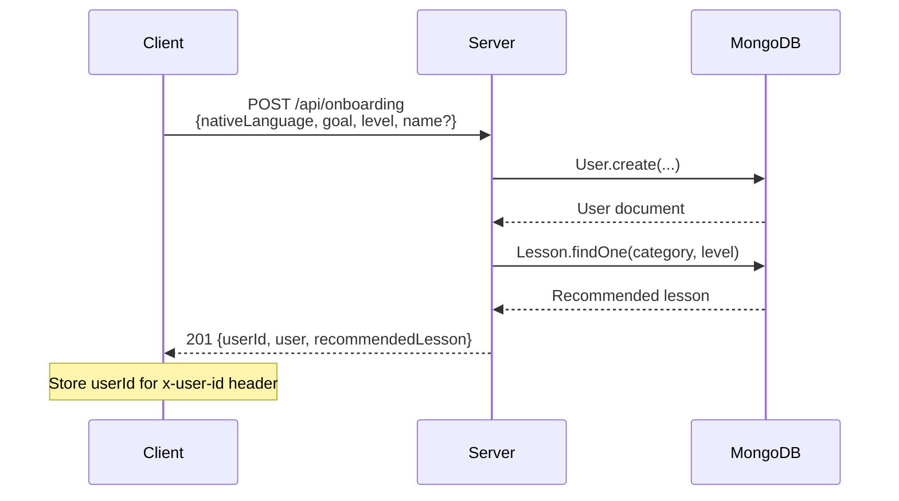
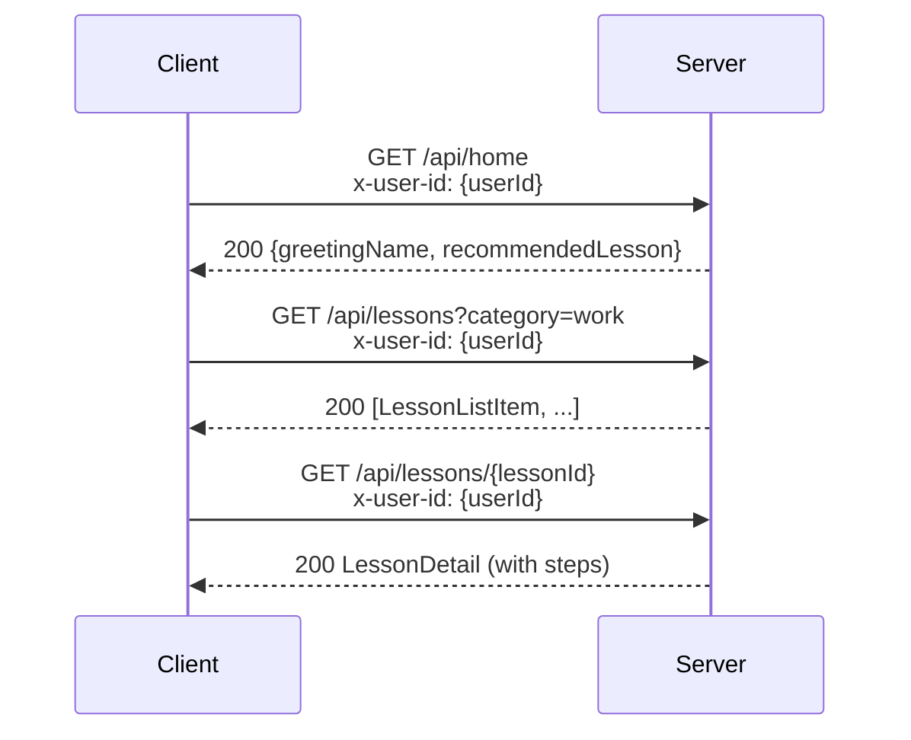
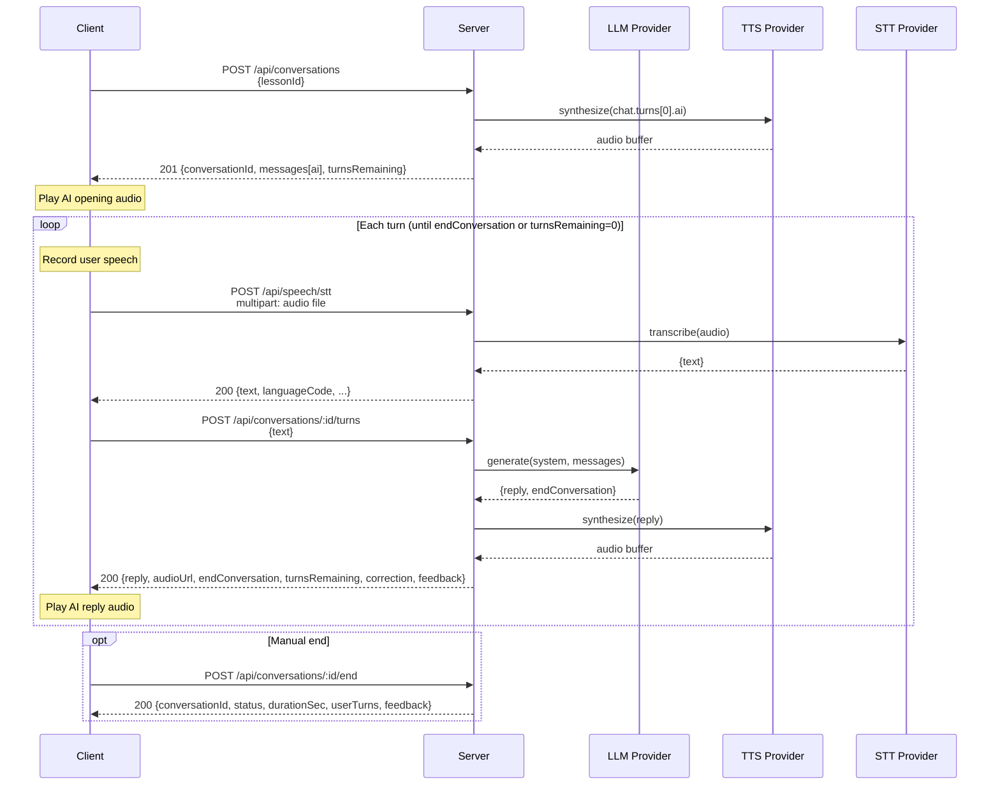

# Zubaan API Reference

> **How to keep this doc updated**: Any change to an endpoint, request/response
> shape, validation rule, or environment variable **must** update this file in
> the same commit. Search for the endpoint's `###` heading and verify every
> field, status code, and example still matches the code.

> **Last verified against code**: 2026-11-01

---

## Table of Contents

1. [Overview](#1-overview)
2. [Global Conventions](#2-global-conventions)
3. [Endpoint Reference](#3-endpoint-reference)
   - [Health](#31-health)
   - [Onboarding](#32-onboarding)
   - [Home](#33-home)
   - [Lessons](#34-lessons)
   - [Conversations](#35-conversations)
   - [Lesson Attempts](#36-lesson-attempts)
   - [Speech — TTS](#37-speech--tts)
   - [Speech — STT](#38-speech--stt)
   - [Mistakes](#39-mistakes)
4. [Data Models](#4-data-models)
5. [Flows](#5-flows)
6. [Providers and Configuration](#6-providers-and-configuration)
7. [Limits and Constraints](#7-limits-and-constraints)
8. [Frontend Integration Notes](#8-frontend-integration-notes)
9. [Not Implemented / Known Gaps](#9-not-implemented--known-gaps)

---

## 1. Overview

Zubaan is an AI English speaking coach for Indian learners. The backend
provides APIs for user onboarding, structured lessons, voice-based roleplay
conversations with LLM-generated AI replies, and speech services (TTS/STT).

| Item               | Value                                    |
| ------------------ | ---------------------------------------- |
| Base URL           | `http://<host>:<PORT>`                   |
| API prefix         | `/api`                                   |
| Versioning         | None (no version prefix)                 |
| Transport          | JSON over HTTP (audio via multipart)     |
| Framework          | Express 5 (Node.js + TypeScript)         |
| Database           | MongoDB (Mongoose ODM)                   |
| Auth mechanism     | `x-user-id` header (see §2)             |
| Static audio files | Served at `/audio/<filename>`            |

The server also exposes:
- `GET /health` — outside `/api`, no auth required.
- `GET /audio/*` — static file serving for generated TTS audio.

---

## 2. Global Conventions

### 2.1 Authentication

There is **no real auth** (no JWT, no OTP). Identity is established via:

| Header       | Value                            | Required on            |
| ------------ | -------------------------------- | ---------------------- |
| `x-user-id`  | MongoDB ObjectId string (24 hex) | Every endpoint **except** `POST /api/onboarding` and `GET /health` |

The `attachUser` middleware:
1. Reads `x-user-id` from the request header.
2. Validates it is a valid Mongoose ObjectId.
3. Loads the `User` document from MongoDB.
4. If missing, invalid, or no matching user → responds **401**.

```json
{ "error": { "message": "Unauthorized" } }
```

`POST /api/onboarding` does **not** use `attachUser`; it creates the user.

### 2.2 Success Response Shape

Endpoints return **plain resource JSON** (no wrapper envelope). The HTTP
status code indicates success.

The only exception is `GET /health`, which uses a wrapper:

```json
{ "success": true, "message": "API is running" }
```

### 2.3 Error Response Shape

All errors follow this envelope:

```json
{
  "error": {
    "message": "Human-readable error description"
  }
}
```

The `error` object contains a `message` and may include a machine-readable
`code` for specific validation errors.

### 2.4 Status Codes Used

| Code | Meaning                                                        |
| ---- | -------------------------------------------------------------- |
| 200  | Success                                                        |
| 201  | Resource created (onboarding, conversation start)              |
| 400  | Validation error or bad input                              |
| 401  | Missing or invalid `x-user-id` header                          |
| 422  | Validation failed for an otherwise valid request               |
| 404  | Resource not found (lesson, conversation)                      |
| 409  | Conflict (conversation not active, max turns reached)          |
| 429  | External provider rate limit (proxied from Sarvam)             |
| 500  | Unconfigured provider or unexpected server error               |
| 502  | External provider request failed                               |
| 504  | External provider timed out                                    |

### 2.5 CORS Configuration

CORS is enabled via the `cors` middleware with **default options**: all
origins allowed, standard headers. No custom allowed-headers configuration
exists in code.

### 2.6 Request Validation

Requests that use validation middleware are validated with Zod schemas. The
middleware parses `{ body, params, query }` against the schema; routes without
validation middleware (such as health, home, and mistake summary) do not run a
Zod validation step.

On validation failure, the response is:

```json
{
  "error": {
    "message": "<first Zod issue message>"
  }
}
```

Status code: **400**. Only the **first** validation issue message is
returned; subsequent issues are not surfaced.

Validated data is stored on `res.locals.validated` (the original `req.body`
is not mutated).

### 2.7 Multer Errors

For multipart uploads (STT), if the file exceeds the size limit:

```json
{
  "error": {
    "message": "Audio file exceeds <STT_MAX_FILE_SIZE_BYTES> bytes"
  }
}
```

Status code: **400**. The effective limit is `STT_MAX_FILE_SIZE_BYTES`
(default: **10 MB**, or 10,485,760 bytes). Other multer errors return
`"Invalid multipart upload"`.

### 2.8 Request Body Size Limits

JSON and URL-encoded bodies are limited to **1 MB** (`express.json({ limit: '1mb' })`).

### 2.9 Rate Limits

No application-level rate limiting is implemented. External provider rate
limits (Sarvam 429) are proxied to the client.

---

## 3. Endpoint Reference

### 3.1 Health

#### `GET /health`

| Item           | Value                    |
| -------------- | ------------------------ |
| **Purpose**    | Health check             |
| **Auth**       | No                       |

**Request**: None.

**Success Response** — `200`:

```json
{
  "success": true,
  "message": "API is running"
}
```

**Example curl**:

```bash
curl http://localhost:5000/health
```

---

### 3.2 Onboarding

#### `POST /api/onboarding`

| Item           | Value                                              |
| -------------- | -------------------------------------------------- |
| **Purpose**    | Create a new user and return their first recommendation |
| **Auth**       | No (this **creates** the user)                     |

**Request Body** (`application/json`):

| Field            | Type     | Required | Validation                                                                                                             | Default |
| ---------------- | -------- | -------- | ---------------------------------------------------------------------------------------------------------------------- | ------- |
| `nativeLanguage` | `string` | Yes      | One of: `"hi"`, `"ta"`, `"te"`, `"mr"`, `"bn"`, `"kn"`, `"ml"`, `"gu"`, `"pa"`, `"or"`                                | —       |
| `goal`           | `string` | Yes      | One of: `"daily_conversation"`, `"work"`, `"interviews"`, `"travel"`, `"confidence"`                                   | —       |
| `level`          | `string` | Yes      | One of: `"beginner"`, `"elementary"`, `"intermediate"`, `"advanced"`                                                   | —       |
| `name`           | `string` | No       | Trimmed, max 50 chars                                                                                                  | —       |

**Success Response** — `201`:

```json
{
  "userId": "665f1a2b3c4d5e6f7a8b9c0d",
  "user": {
    "_id": "665f1a2b3c4d5e6f7a8b9c0d",
    "name": "Adnan",
    "nativeLanguage": "hi",
    "level": "elementary",
    "goal": "work",
    "dailyGoalMinutes": 10,
    "placement": {
      "selfReported": "elementary"
    },
    "createdAt": "2026-10-13T07:30:00.000Z",
    "updatedAt": "2026-10-13T07:30:00.000Z"
  },
  "recommendedLesson": {
    "id": "665f1a2b3c4d5e6f7a8b9c0e",
    "slug": "give-your-manager-a-quick-work-update",
    "title": "Give your manager a quick work update",
    "category": "work",
    "level": "elementary",
    "objective": "Share a clear, concise update with your manager.",
    "estimatedMinutes": 6
  }
}
```

`recommendedLesson` may be `null` if no lessons exist in the database.

**Error Responses**:

| Status | When                          | Message (example)                |
| ------ | ----------------------------- | -------------------------------- |
| 400    | Validation fails              | `"Invalid enum value. ..."`      |

**Side Effects**:
- Creates a `User` document in MongoDB with `placement.selfReported` set to
  the provided `level`.

**Example curl**:

```bash
curl -X POST http://localhost:5000/api/onboarding \
  -H "Content-Type: application/json" \
  -d '{
    "nativeLanguage": "hi",
    "goal": "work",
    "level": "elementary",
    "name": "Adnan"
  }'
```

---

### 3.3 Home

#### `GET /api/home`

| Item           | Value                                          |
| -------------- | ---------------------------------------------- |
| **Purpose**    | Dashboard data: greeting + recommended lesson  |
| **Auth**       | Yes — `x-user-id` header                       |

**Request**: No body, no query params.

**Success Response** — `200`:

```json
{
  "greetingName": "Adnan",
  "recommendedLesson": {
    "id": "665f1a2b3c4d5e6f7a8b9c0e",
    "slug": "give-your-manager-a-quick-work-update",
    "title": "Give your manager a quick work update",
    "category": "work",
    "level": "elementary",
    "objective": "Share a clear, concise update with your manager.",
    "estimatedMinutes": 6
  }
}
```

`greetingName` defaults to `"there"` if the user has no name.
`recommendedLesson` may be `null`.

**Error Responses**:

| Status | When                          | Message             |
| ------ | ----------------------------- | ------------------- |
| 401    | Missing/invalid `x-user-id`  | `"Unauthorized"`    |

**Example curl**:

```bash
curl http://localhost:5000/api/home \
  -H "x-user-id: 665f1a2b3c4d5e6f7a8b9c0d"
```

---

### 3.4 Lessons

#### `GET /api/lessons`

| Item           | Value                                |
| -------------- | ------------------------------------ |
| **Purpose**    | List lessons, optionally filtered    |
| **Auth**       | Yes — `x-user-id` header            |

**Query Parameters**:

| Param      | Type     | Required | Validation                                                      |
| ---------- | -------- | -------- | --------------------------------------------------------------- |
| `category` | `string` | No       | One of: `"daily"`, `"work"`, `"career"`, `"travel"`             |
| `level`    | `string` | No       | One of: `"beginner"`, `"elementary"`, `"intermediate"`, `"advanced"` |
| `lang`     | `string` | No       | Supported language; defaults to the user's native language, then `"hi"` |

**Success Response** — `200`:

```json
[
  {
    "id": "665f1a2b3c4d5e6f7a8b9c0e",
    "slug": "introduce-yourself-to-a-new-neighbour",
    "title": "Introduce yourself to a new neighbour",
    "category": "daily",
    "level": "beginner",
    "unit": "introductions",
    "order": 1,
    "canDo": "I can introduce myself to a new neighbour.",
    "objective": "Start a friendly conversation with a new neighbour.",
    "estimatedMinutes": 5,
    "sentenceCount": 6,
    "exerciseCount": 12
  }
]
```

Returns an empty array `[]` if no lessons match.

**Error Responses**:

| Status | When                          | Message               |
| ------ | ----------------------------- | --------------------- |
| 400    | Invalid query param value     | Zod issue message     |
| 401    | Missing/invalid `x-user-id`  | `"Unauthorized"`      |

**Example curl**:

```bash
curl "http://localhost:5000/api/lessons?category=work&level=elementary" \
  -H "x-user-id: 665f1a2b3c4d5e6f7a8b9c0d"
```

---

#### `GET /api/lessons/:id`

| Item           | Value                                         |
| -------------- | --------------------------------------------- |
| **Purpose**    | Get full lesson detail including stages and chat |
| **Auth**       | Yes — `x-user-id` header                      |

**Path Parameters**:

| Param | Type     | Required | Validation                     |
| ----- | -------- | -------- | ------------------------------ |
| `id`  | `string` | Yes      | Trimmed, min 1 char (ObjectId) |

**Query Parameters**:

| Param  | Type     | Required | Validation |
|--------|----------|----------|------------|
| `lang` | `string` | No       | Supported language; defaults to the user's native language, then `"hi"` |

**Success Response** — `200`:

```json
{
  "id": "665f1a2b3c4d5e6f7a8b9c0e",
  "slug": "introduce-yourself-to-a-new-neighbour",
  "title": "Introduce yourself to a new neighbour",
  "category": "daily",
  "level": "beginner",
  "unit": "introductions",
  "order": 1,
  "canDo": "I can introduce myself to a new neighbour.",
  "focus": "polite questions",
  "objective": "Start a friendly conversation with a new neighbour.",
  "estimatedMinutes": 5,
  "sentences": [
    {
      "id": "s1",
      "text": "Hi, I am your new neighbour.",
      "hi": "नमस्ते, मैं आपका नया पड़ोसी हूँ।",
      "meaning": "नमस्ते, मैं आपका नया पड़ोसी हूँ।",
      "tip": "Say \"neighbour\" as NAY-bur.",
      "chunks": ["Hi,", "I am", "your new", "neighbour."]
    }
  ],
  "stages": [
    {
      "id": "words",
      "title": "Learn the words",
      "intro": "Meet the words you will need.",
      "exercises": [{ "id": "w1", "type": "match_pairs", "prompt": "Match each word.", "pairs": [{ "en": "neighbour", "hi": "पड़ोसी" }] }]
    }
  ],
  "chat": {
    "aiRole": "Neighbour",
    "userRole": "New resident",
    "situation": "You meet outside your building.",
    "goal": "Introduce yourself.",
    "turns": [{
      "ai": "Are you new in the building?",
      "sentenceId": "s1",
      "hint": { "en": "Greet your neighbour.", "hi": "नमस्ते कहें।", "native": "नमस्ते कहें।" }
    }],
    "closingLine": "Welcome to the building!"
  }
}
```

**Error Responses**:

| Status | When                          | Message                |
| ------ | ----------------------------- | ---------------------- |
| 401    | Missing/invalid `x-user-id`  | `"Unauthorized"`       |
| 404    | Invalid ObjectId or not found | `"Lesson not found"`   |
| 400    | Requested language is unsupported | Error code `"LANG_NOT_SUPPORTED"` |
| 404    | Lesson translation is missing | Error code `"TRANSLATION_NOT_FOUND"` |

**Example curl**:

```bash
curl http://localhost:5000/api/lessons/665f1a2b3c4d5e6f7a8b9c0e \
  -H "x-user-id: 665f1a2b3c4d5e6f7a8b9c0d"
```

---

### 3.5 Conversations

#### `POST /api/conversations`

| Item           | Value                                                |
| -------------- | ---------------------------------------------------- |
| **Purpose**    | Start a new conversation from a lesson's chat       |
| **Auth**       | Yes — `x-user-id` header                             |

**Request Body** (`application/json`):

| Field      | Type     | Required | Validation                     |
| ---------- | -------- | -------- | ------------------------------ |
| `lessonId` | `string` | Yes      | Trimmed, min 1 char (ObjectId) |
| `attemptId` | `string` | No      | An attempt for the same lesson and owner |

**Success Response** — `201`:

```json
{
  "conversationId": "665f1a2b3c4d5e6f7a8b9c10",
  "attemptId": null,
  "status": "active",
  "messages": [
    {
      "role": "ai",
      "text": "Hello! I have not seen you here before. Are you new to the building?",
      "audioUrl": "/audio/a1b2c3d4-e5f6-7890-abcd-ef1234567890.wav",
      "createdAt": "2026-10-13T07:35:00.000Z"
      ,"turnIndex": 0
    }
  ],
  "turnsRemaining": 18
}
```

`audioUrl` may be `null` if TTS synthesis fails (failure is swallowed).

**Error Responses**:

| Status | When                            | Message                          |
| ------ | ------------------------------- | -------------------------------- |
| 400    | Validation fails                | Zod issue message                |
| 400    | Lesson has no conversation turns | `"Lesson has no conversation turns"` |
| 401    | Missing/invalid `x-user-id`    | `"Unauthorized"`                 |
| 404    | Lesson not found / invalid ID  | `"Lesson not found"`             |

**Side Effects**:
- Creates a `Conversation` document with status `"active"`.
- The AI opening message is `chat.turns[0].ai`.
- TTS is called to synthesize the opening line; audio is saved to disk.
- A `SpeechLog` document is created for the TTS call.

If `attemptId` is supplied, it is stored on the conversation and must belong
to the same lesson and owner. Conversation responses include `attemptId`
(`null` when absent).

**Example curl**:

```bash
curl -X POST http://localhost:5000/api/conversations \
  -H "Content-Type: application/json" \
  -H "x-user-id: 665f1a2b3c4d5e6f7a8b9c0d" \
  -d '{ "lessonId": "665f1a2b3c4d5e6f7a8b9c0e" }'
```

---

---

#### `POST /api/conversations/:id/turns`

| Item           | Value                                                     |
| -------------- | --------------------------------------------------------- |
| **Purpose**    | Send user text, receive AI reply (the core conversation turn) |
| **Auth**       | Yes — `x-user-id` header                                  |

**Path Parameters**:

| Param | Type     | Required | Validation                     |
| ----- | -------- | -------- | ------------------------------ |
| `id`  | `string` | Yes      | Trimmed, min 1 char (ObjectId) |

**Request Body** (`application/json`):

| Field  | Type     | Required | Validation             |
| ------ | -------- | -------- | ---------------------- |
| `text` | `string` | Yes      | Trimmed, 1–500 chars   |

**Success Response** — `200`:

```json
{
  "reply": "That sounds great! How are you finding the neighbourhood so far?",
  "audioUrl": "/audio/b2c3d4e5-f6a7-8901-bcde-f12345678901.wav",
  "endConversation": false,
  "turnsRemaining": 3,
  "progress": { "current": 2, "total": 5 },
  "hasMistake": true,
  "corrected": "I went to the market yesterday.",
  "explanation": "Use \"went\" as the past tense of \"go\".",
  "mistakeType": "tense",
  "correction": {
    "corrected": "I went to the market yesterday.",
    "explanation": "Use \"went\" as the past tense of \"go\".",
    "type": "tense"
  },
  "revealHint": false,
  "feedback": null
}
```

`audioUrl` may be `null` if TTS fails.

`correction` is `null` when the learner's message has no mistake. When
present it contains the corrected sentence, a short explanation, and a
mistake type. For scripted turns, `hasMistake` and `corrected` can be present
even when the answer did not advance the turn. See `Correction` in §4.
`feedback` is `null` unless this turn completed the conversation.
`revealHint` (`boolean`) — scripted-lesson turns only. `true` when the
learner's second consecutive off-target attempt triggers the repeat prompt,
indicating the client should reveal the expected sentence hint. `false` on
all other turns (including the first off-target attempt, close / exact
matches, and non-scripted conversations).

When `endConversation` is `true`, the conversation status changes to
`"completed"` and no further turns can be taken.

**Error Responses**:

| Status | When                                           | Message                                                                          |
| ------ | ---------------------------------------------- | -------------------------------------------------------------------------------- |
| 400    | Validation fails                               | Zod issue message                                                                |
| 401    | Missing/invalid `x-user-id`                   | `"Unauthorized"`                                                                 |
| 404    | Conversation not found or not owned by user    | `"Conversation not found"`                                                       |
| 404    | Lesson associated with conversation not found  | `"Lesson not found"`                                                             |
| 409    | Conversation not active or max turns reached   | `"Cannot take turn: conversation is not active or has reached the maximum number of turns"` |
| 502    | LLM returned invalid JSON after retry          | `"AI response was invalid"`                                                      |

**Side Effects**:
- Appends the user message to `conversation.messages` (atomic update with
  guard against exceeding `chat.turns.length * 3`).
- Scripted lessons compare the answer with the current turn target, return
  progress and correction fields, and never call the LLM.
- Calls the LLM provider to generate a response (validated JSON) which
  now includes correction fields alongside the reply.
- Computes a `Correction` from the LLM output and attaches it to the user
  message (same save that appends the AI message).
- Calls TTS to synthesize the AI reply; audio saved to disk.
- Appends the AI message to `conversation.messages`.
- If `turnsRemaining === 0` or LLM sets `endConversation: true`, the
  conversation status is set to `"completed"`, `endedAt` and `durationSec`
  are recorded.
- If LLM fails, the user message is rolled back (`$pop`).
- `SpeechLog` documents created for TTS calls.

**Example curl**:

```bash
curl -X POST http://localhost:5000/api/conversations/665f1a2b3c4d5e6f7a8b9c10/turns \
  -H "Content-Type: application/json" \
  -H "x-user-id: 665f1a2b3c4d5e6f7a8b9c0d" \
  -d '{ "text": "Hi, I am your new neighbour. I just moved in last week." }'
```

---

#### `POST /api/conversations/:id/end`

| Item           | Value                                      |
| -------------- | ------------------------------------------ |
| **Purpose**    | Manually end an active conversation        |
| **Auth**       | Yes — `x-user-id` header                   |

**Path Parameters**:

| Param | Type     | Required | Validation                     |
| ----- | -------- | -------- | ------------------------------ |
| `id`  | `string` | Yes      | Trimmed, min 1 char (ObjectId) |

**Request Body**: None.

**Success Response** — `200`:

```json
{
  "conversationId": "665f1a2b3c4d5e6f7a8b9c10",
  "status": "completed",
  "durationSec": 185,
  "userTurns": 3,
  "feedback": {
    "userTurns": 3,
    "durationSec": 185,
    "mistakeCount": 1,
    "corrections": [
      {
        "original": "I goed to market yesterday",
        "corrected": "I went to market yesterday",
        "explanation": "Use \"went\" as the past tense of \"go\".",
        "type": "tense"
      }
    ],
    "targetPhrases": {
      "used": ["I just moved in last week."],
      "missed": ["Hi, I am your new neighbour.", "It is nice to meet you."]
    }
  }
}
```

If the conversation was already `"completed"`, the response returns its
existing data (idempotent for completed status).

`feedback` contains `userTurns`, `durationSec` (`number | null`),
`mistakeCount`, `corrections[]`, and `targetPhrases.used` / `missed`.

**Error Responses**:

| Status | When                                         | Message                       |
| ------ | -------------------------------------------- | ----------------------------- |
| 401    | Missing/invalid `x-user-id`                 | `"Unauthorized"`              |
| 404    | Conversation not found or not owned by user  | `"Conversation not found"`    |
| 409    | Conversation is `"abandoned"`                | `"Conversation is not active"` |

**Side Effects**:
- Sets `status` to `"completed"`, `endedAt` to now, calculates `durationSec`
  from `startedAt`.

**Example curl**:

```bash
curl -X POST http://localhost:5000/api/conversations/665f1a2b3c4d5e6f7a8b9c10/end \
  -H "x-user-id: 665f1a2b3c4d5e6f7a8b9c0d"
```

---

#### `GET /api/conversations/:id`

| Item           | Value                                    |
| -------------- | ---------------------------------------- |
| **Purpose**    | Retrieve full conversation with messages |
| **Auth**       | Yes — `x-user-id` header                 |

**Path Parameters**:

| Param | Type     | Required | Validation                     |
| ----- | -------- | -------- | ------------------------------ |
| `id`  | `string` | Yes      | Trimmed, min 1 char (ObjectId) |

**Success Response** — `200`:

```json
{
  "conversationId": "665f1a2b3c4d5e6f7a8b9c10",
  "lessonId": "665f1a2b3c4d5e6f7a8b9c0e",
  "status": "active",
  "messages": [
    {
      "role": "ai",
      "text": "Hello! I have not seen you here before. Are you new to the building?",
      "audioUrl": "/audio/a1b2c3d4-e5f6-7890-abcd-ef1234567890.wav",
      "createdAt": "2026-10-13T07:35:00.000Z"
    },
    {
      "role": "user",
      "text": "I goed to the market yesterday.",
      "audioUrl": null,
      "correction": {
        "corrected": "I went to the market yesterday.",
        "explanation": "Use \"went\" as the past tense of \"go\".",
        "type": "tense"
      },
      "createdAt": "2026-10-13T07:35:30.000Z"
    }
  ],
  "startedAt": "2026-10-13T07:35:00.000Z",
  "feedback": null
}
```

`feedback` is non-null only when status is completed. `endedAt` and
`durationSec` are omitted while status is active and present once completed.

**Error Responses**:

| Status | When                                         | Message                    |
| ------ | -------------------------------------------- | -------------------------- |
| 401    | Missing/invalid `x-user-id`                 | `"Unauthorized"`           |
| 404    | Conversation not found or not owned by user  | `"Conversation not found"` |

**Example curl**:

```bash
curl http://localhost:5000/api/conversations/665f1a2b3c4d5e6f7a8b9c10 \
  -H "x-user-id: 665f1a2b3c4d5e6f7a8b9c0d"
```

---

### 3.6 Lesson Attempts

All attempt endpoints require `x-user-id`.

#### `POST /api/lessons/:lessonId/attempts`

Creates an attempt and returns `201 { "attemptId": "..." }`.

#### `POST /api/attempts/:attemptId/results`

Request body:

```json
{
  "exerciseId": "g3",
  "result": "wrong",
  "answer": "move",
  "retry": false
}
```

`result` is `correct | wrong` for `mcq`, `gap`, `listen_pick`, `order_words`,
and `match_pairs`; it is `said | close | missed | skipped` for `speak`.
`answer` is a string for MCQ/gap/listen-pick and an array of at most 30
strings, each at most 40 characters, for order-words. The answer text, or
the joined order-words answer, must be at most 500 characters. The server
resolves `stageId` and exercise type from the stored lesson. A second
non-retry submission returns `{ "recorded": false, "mistakeSaved": false }`.
Retries only accept `correct` or `wrong`, update `retryResult`, and never
create a mistake.

Success response (`200`):

```json
{ "recorded": true, "mistakeSaved": true }
```

#### `POST /api/attempts/:attemptId/complete`

Request body: `{ "bestStreak": 0 }`, where `bestStreak` is an integer from 0
through 200. The `200` response is the same attempt object returned by the GET.

#### `GET /api/attempts/:attemptId`

Returns:

```json
{
  "attemptId": "...",
  "lessonId": "...",
  "startedAt": "2026-10-27T00:00:00.000Z",
  "completedAt": null,
  "bestStreak": 0,
  "results": [
    { "exerciseId": "g3", "stageId": "sentences", "type": "gap", "result": "wrong", "retryResult": null }
  ],
  "mistakes": [
    { "exerciseId": "g3", "original": "I just move in last week.", "corrected": "I just moved in last week.", "explanation": "...", "mistakeType": "tense" }
  ]
}
```

An exercise mistake is saved only for a first, non-retry `wrong` result with
an exercise `mistakeType` and an answer. Mistake-bank records are deduplicated
using the same user, lesson, original, corrected, and type key as conversation
corrections.

### 3.7 Speech — TTS

#### `POST /api/speech/tts`

| Item           | Value                                              |
| -------------- | -------------------------------------------------- |
| **Purpose**    | Synthesize text to speech, return audio URL         |
| **Auth**       | Yes — `x-user-id` header                           |

**Request Body** (`application/json`):

| Field      | Type     | Required | Validation                                              | Default                |
| ---------- | -------- | -------- | ------------------------------------------------------- | ---------------------- |
| `text`     | `string` | Yes      | Trimmed, 1–2500 chars                                   | —                      |
| `language` | `string` | Yes      | One of: `"en-IN"`, `"hi-IN"`, `"ta-IN"`, `"te-IN"`     | —                      |
| `provider` | `string` | No       | One of: `"kokoro"`, `"sarvam"`                          | `env.TTS_PROVIDER`     |
| `voice`    | `string` | No       | Trimmed, 1–120 chars                                    | Provider default       |
| `pace`     | `number` | No       | 0.5–2.0                                                 | Provider default       |

The 2500-character limit is validated before provider selection. Requests
over the limit return the standard validation response shown below and do not
reach a TTS provider.

**Success Response** — `200`:

```json
{
  "audioUrl": "/audio/c3d4e5f6-a7b8-9012-cdef-123456789012.wav",
  "provider": "sarvam",
  "voice": "shubh",
  "pace": 1,
  "chars": 42,
  "totalMs": 1523,
  "durationMs": null,
  "cached": false
}
```

| Field        | Type              | Description                                    |
| ------------ | ----------------- | ---------------------------------------------- |
| `audioUrl`   | `string`          | Relative path to the stored audio file         |
| `provider`   | `string`          | Provider used (`"kokoro"` or `"sarvam"`)       |
| `voice`      | `string`          | Effective voice used, including the provider default when omitted |
| `pace`       | `number \| null`  | Pace used, or null if not specified             |
| `chars`      | `number`          | Character count of input text                  |
| `totalMs`    | `number`          | Wall-clock time of the provider call (ms)      |
| `durationMs` | `number \| null`  | Duration of generated audio (ms), if available |
| `cached`     | `boolean`          | True when an existing file was reused. On a hit no provider call is made: `totalMs` is 0, `durationMs` is null and no `SpeechLog` is written. |

**Error Responses**:

| Status | When                                                      | Message                                                       |
| ------ | --------------------------------------------------------- | ------------------------------------------------------------- |
| 400    | Validation fails                                          | Zod issue message                                             |
| 400    | Kokoro + non-English language                             | `"Kokoro supports English only"`                              |
| 400    | Text exceeds 2500 chars                                   | Zod validation response, e.g. `{"error":{"message":"Too big: expected string to have <=2500 characters"}}` |
| 401    | Missing/invalid `x-user-id`                              | `"Unauthorized"`                                              |
| 429    | Sarvam rate limit                                         | `"TTS provider rate limit exceeded"`                          |
| 500    | Provider not configured (missing API key)                 | `"TTS provider is not configured"`                            |
| 502    | Provider returned bad data or request failed              | `"TTS provider request failed"`                               |
| 502    | Sarvam auth failed (401/403 from Sarvam)                  | `"TTS provider authentication failed"`                        |
| 504    | Provider timed out                                        | `"TTS provider timed out"`                                    |

**Side Effects**:
- Audio file saved to `storage/audio/` directory.
- A `SpeechLog` document is created (kind: `"tts"`) only when the TTS provider
  is called. Cache hits reuse the saved audio and do not create a log.

**Example curl**:

```bash
curl -X POST http://localhost:5000/api/speech/tts \
  -H "Content-Type: application/json" \
  -H "x-user-id: 665f1a2b3c4d5e6f7a8b9c0d" \
  -d '{
    "text": "Hello! How are you doing today?",
    "language": "en-IN",
    "provider": "sarvam",
    "voice": "shubh",
    "pace": 1
  }'
```

---

### 3.8 Speech — STT

#### `POST /api/speech/stt`

| Item           | Value                                            |
| -------------- | ------------------------------------------------ |
| **Purpose**    | Transcribe uploaded audio to text                |
| **Auth**       | Yes — `x-user-id` header                         |

**Request**: `multipart/form-data`

| Form Field   | Type   | Required | Validation / Constraints                            |
| ------------ | ------ | -------- | --------------------------------------------------- |
| `audio`      | File   | Yes      | Max `STT_MAX_FILE_SIZE_BYTES` (default: 10 MB / 10,485,760 bytes). Format is detected from the file bytes. |
| `language`   | string | No       | One of the STT language codes (see §4.5). Default: `"unknown"`. |
| `provider`   | string | No       | One of: `"sarvam"`. Default: `env.STT_PROVIDER`.    |
| `mode`       | string | No       | One of `"transcribe"`, `"verbatim"`, `"codemix"`, `"translit"`. Default: `env.SARVAM_STT_MODE`. |

**Accepted formats** are WAV, M4A/AAC, MP3, OGG, WebM, FLAC, AMR, and CAF.
Detection uses the uploaded bytes rather than the client MIME type or filename,
so `application/octet-stream` and incorrect filenames are supported. The server
converts accepted audio to a 16 kHz, mono, 16-bit PCM WAV before sending it to
the STT provider. Recommended client format: **m4a or wav, 16 kHz mono is best**.

**Success Response** — `200`:

```json
{
  "text": "Hi, I am your new neighbour. I just moved in last week.",
  "languageCode": "en-IN",
  "provider": "sarvam",
  "mode": "codemix",
  "totalMs": 2341,
  "durationSeconds": 4.5
}
```

| Field            | Type              | Description                                |
| ---------------- | ----------------- | ------------------------------------------ |
| `text`           | `string`          | Transcribed text                           |
| `languageCode`   | `string \| null`  | Detected/specified language code           |
| `provider`       | `string`          | Provider used (`"sarvam"`)                 |
| `mode`          | `string`       | Mode used for the transcription            |
| `totalMs`        | `number`       | Wall-clock time of the provider call (ms)  |
| `durationSeconds`| `number \| null`  | Duration of the input audio when metadata can determine it; otherwise `null` |

The server normalizes audio before checking duration and silence. The response
shape is unchanged; `totalMs` includes normalization, validation, and provider
work.

**Error Responses**:

| Status | When                                              | Message                                                              |
| ------ | ------------------------------------------------- | -------------------------------------------------------------------- |
| 400    | No file uploaded                                  | `"audio file is required"`                                           |
| 400    | File exceeds size limit                           | `"Audio file exceeds <STT_MAX_FILE_SIZE_BYTES> bytes"`                |
| 415    | Unsupported audio bytes                          | `"Unsupported audio format. Send WAV, M4A/AAC, MP3, OGG, WebM, FLAC, AMR or CAF."` (`code`: `"UNSUPPORTED_AUDIO_FORMAT"`) |
| 422    | Audio cannot be decoded or transcoded             | `"We couldn't read that audio. Please record again."` (`code`: `"AUDIO_UNREADABLE"`) |
| 413    | Audio duration exceeds max                        | `"Audio exceeds the maximum duration."` (`code`: `"AUDIO_TOO_LONG"`) |
| 400    | Sarvam rejects invalid audio input (422)            | `"Invalid audio input"`                                                |
| 400    | Sarvam rejects audio exceeding its duration limit (422) | `"Sarvam STT REST supports up to 30 seconds per request"`            |
| 422    | WAV input evaluated by `measureWav`: peak amplitude below the silence threshold (< 0.03) or duration shorter than 0.3 seconds | `"We didn't hear anything. Check that your mic is on and try again."` (`code`: `"AUDIO_TOO_QUIET"`) |
| 401    | Missing/invalid `x-user-id`                      | `"Unauthorized"`                                                     |
| 429    | Sarvam rate limit                                 | `"STT provider rate limit exceeded"`                                 |
| 500    | Provider not configured                           | `"STT provider is not configured"`                                   |
| 502    | Provider returned bad data or request failed      | `"STT provider request failed"`                                      |
| 502    | Sarvam auth failed                                | `"STT provider authentication failed"`                               |
| 504    | Provider timed out                                | `"STT provider timed out"`                                           |

**Side Effects**:
- A `SpeechLog` document is created (kind: `"stt"`).
- Audio is **not** persisted to disk (processed in-memory only).

**Example curl**:

```bash
curl -X POST http://localhost:5000/api/speech/stt \
  -H "x-user-id: 665f1a2b3c4d5e6f7a8b9c0d" \
  -F "audio=@recording.wav;type=audio/wav" \
  -F "language=en-IN"
```

---

### 3.9 Mistakes

The mistake bank stores non-null corrections found during conversation turns
and returns only the authenticated user's mistakes.

**Authentication**: `x-user-id` header.

#### `GET /api/mistakes`

Lists mistakes newest first using cursor pagination.

| Query parameter | Type   | Required | Notes |
| --------------- | ------ | -------- | ----- |
| `type`          | string | No       | `grammar`, `tense`, `preposition`, `word_choice`, or `other` |
| `limit`         | number | No       | 1–50; default `20` |
| `before`        | string | No       | 24-character MongoDB ObjectId cursor |

**Response `200`**:

```json
{
  "items": [
    {
      "id": "665f1a2b3c4d5e6f7a8b9c0d",
      "original": "I goed there",
      "corrected": "I went there",
      "explanation": "Use the past tense went, not goed.",
      "type": "tense",
      "conversationId": "665f1a2b3c4d5e6f7a8b9c0e",
      "lessonId": "665f1a2b3c4d5e6f7a8b9c0f",
      "createdAt": "2026-10-23T12:00:00.000Z"
    }
  ],
  "nextBefore": "665f1a2b3c4d5e6f7a8b9c0d"
}
```

Pass the previous response's `nextBefore` as `before` to fetch the next page;
`null` means there are no more pages.

**Errors**:

| Status | Condition |
| ------ | --------- |
| 400    | Invalid query or cursor |
| 401    | Missing or invalid `x-user-id` |

#### `GET /api/mistakes/summary`

Returns the authenticated user's total mistakes and counts by mistake type.

**Response `200`**:

```json
{
  "total": 1,
  "byType": {
    "grammar": 0,
    "tense": 1,
    "preposition": 0,
    "word_choice": 0,
    "other": 0
  }
}
```

**Errors**:

| Status | Condition |
| ------ | --------- |
| 401    | Missing or invalid `x-user-id` |

**Example curl**:

```bash
curl "http://localhost:5000/api/mistakes?type=tense&limit=20" \
  -H "x-user-id: 665f1a2b3c4d5e6f7a8b9c0d"

curl "http://localhost:5000/api/mistakes/summary" \
  -H "x-user-id: 665f1a2b3c4d5e6f7a8b9c0d"
```

---

## 4. Data Models

### 4.1 User

| Field              | Type     | Required | Default | Notes                          |
| ------------------ | -------- | -------- | ------- | ------------------------------ |
| `_id`              | ObjectId | Auto     | —       | MongoDB auto-generated         |
| `name`             | string   | No       | —       | Trimmed                        |
| `nativeLanguage`   | string   | Yes      | —       | Enum: see `Language` below     |
| `level`            | string   | Yes      | —       | Enum: see `Level` below        |
| `goal`             | string   | Yes      | —       | Enum: see `Goal` below         |
| `dailyGoalMinutes` | number   | No       | `10`    |                                |
| `placement.selfReported` | string | Yes   | —       | Enum: `Level`                  |
| `placement.measured`     | string | No    | —       | Enum: `Level`                  |
| `createdAt`        | Date     | Auto     | —       | Mongoose timestamps            |
| `updatedAt`        | Date     | Auto     | —       | Mongoose timestamps            |

### 4.2 Lesson

| Field              | Type           | Required | Notes                         |
| ------------------ | -------------- | -------- | ----------------------------- |
| `_id`              | ObjectId       | Auto     |                               |
| `slug`             | string         | Yes      | Unique, indexed               |
| `title`            | string         | Yes      |                               |
| `category`         | string         | Yes      | Enum: `LessonCategory`        |
| `level`            | string         | Yes      | Enum: `Level`                 |
| `objective`        | string         | Yes      |                               |
| `estimatedMinutes` | number         | Yes      |                               |
| `sentenceCount` | number | Yes | List response count |
| `exerciseCount` | number | Yes | List response count |
| `sentences`        | `Sentence[]`   | Yes      | Learner sentence source        |
| `stages`           | `Stage[]`      | Yes      | Embedded array (see below)    |
| `chat`             | `Chat`         | Yes      | Scripted conversation          |
| `createdAt`        | Date           | Auto     |                               |
| `updatedAt`        | Date           | Auto     |                               |

**Sentence**:

| Field | Type | Required | Notes |
| ----- | ---- | -------- | ----- |
| `id` | string | Yes | Referenced by chat turns and speak exercises |
| `text` | string | Yes | Sentence the learner says |
| `hi` | string | Yes | Hindi meaning |
| `tip` | string | Yes | Pronunciation or grammar tip |
| `chunks` | string[] | Yes | Joins to `text` |

**Stage**:

`{ id: "words" | "sentences"; title: string; intro: string; exercises: Exercise[] }`.
Exercises are `mcq`, `gap`, `listen_pick`, `match_pairs`, `order_words`, or
`speak`; see `docs/LESSON_CONTENT.md` for every field. Exercises include
`correct` in lesson detail responses.

**Chat**:

`Chat` has `aiRole`, `userRole`, `situation`, `goal`, `turns`, and `closingLine`.
Each detail response turn contains only `ai`, `sentenceId`, and `hint`.
Authoring-only fields `repeat`, `alternatives`, and `knownMistakes` are not
exposed.

**Scripted chat authoring**:

Each turn also has `repeat`, optional `alternatives`, and optional
`knownMistakes`; `sentenceId` resolves the expected text from `sentences`.

### 4.3 Conversation

| Field        | Type                        | Required | Default       | Notes                     |
| ------------ | --------------------------- | -------- | ------------- | ------------------------- |
| `_id`        | ObjectId                    | Auto     | —             |                           |
| `userId`     | ObjectId (ref: User)        | Yes      | —             | Indexed                   |
| `lessonId`   | ObjectId (ref: Lesson)      | Yes      | —             |                           |
| `status`     | string                      | Yes      | `"active"`    | `"active"` \| `"completed"` \| `"abandoned"` |
| `messages`   | `ConversationMessage[]`     | Yes      | `[]`          | Embedded array            |
| `startedAt`  | Date                        | Yes      | `Date.now`    |                           |
| `endedAt`    | Date                        | No       | —             |                           |
| `durationSec`| number                      | No       | —             | Min: 0                    |
| `script`     | `{ turnIndex: number; attempts: number }` | No | `{ turnIndex: 0, attempts: 0 }` | Internal scripted state; not serialized |
| `createdAt`  | Date                        | Auto     | —             |                           |
| `updatedAt`  | Date                        | Auto     | —             |                           |

**ConversationMessage**:

| Field        | Type                  | Required | Default      | Notes |
| ------------ | --------------------- | -------- | ------------ | ----- |
| `role`       | string                | Yes      | —            | `"user"` \| `"ai"` |
| `text`       | string                | Yes      | —            | Trimmed |
| `audioUrl`   | string                | No       | `null`       | |
| `correction` | `Correction` \| null  | No       | `null`       | User messages only. See `Correction` below. |
| `createdAt`  | Date                  | Yes      | `Date.now`   | |
| `turnIndex`   | number                | Yes      | `0`          | Script turn associated with the message |
| `outcome`     | string                | No       | —            | User messages: `"exact"` \| `"close"` \| `"off"` \| `"moved_on"` |
| `revealHint`  | boolean               | No       | —            | AI messages only |

**Correction** (embedded in user messages when a mistake is found):

| Field         | Type          | Required | Notes |
| ------------- | ------------- | -------- | ----- |
| `corrected`   | string        | Yes      | The corrected sentence |
| `explanation` | string        | Yes      | One short sentence, max 160 chars |
| `type`        | `MistakeType` | Yes      | See §4.5 |

### 4.4 SpeechLog

| Field         | Type     | Required | Notes                              |
| ------------- | -------- | -------- | ---------------------------------- |
| `_id`         | ObjectId | Auto     |                                    |
| `kind`        | string   | Yes      | `"tts"` \| `"stt"`                |
| `provider`    | string   | Yes      | `"kokoro"` \| `"sarvam"`          |
| `voice`       | string   | No       | TTS only                           |
| `pace`        | number   | No       | TTS only                           |
| `language`    | string   | Yes      |                                    |
| `chars`       | number   | No       | TTS: character count               |
| `audioSeconds`| number   | No       | STT: input audio duration          |
| `mimeType`    | string   | No       | STT: input audio MIME type         |
| `mode`        | string   | No       | STT transcription mode used         |
| `audioBytes`  | number   | Yes      |                                    |
| `durationMs`  | number   | No       | TTS: generated audio duration (ms) |
| `totalMs`     | number   | Yes      | Wall-clock provider call time (ms) |
| `ok`          | boolean  | Yes      |                                    |
| `error`       | string   | No       | Max 160 chars                      |
| `createdAt`   | Date     | Yes      | Default: now                       |

**Mistake**:

| Field            | Type       | Required | Default | Notes |
| ---------------- | ---------- | -------- | ------- | ----- |
| `_id`            | ObjectId   | Auto     | —       | |
| `userId`         | ObjectId   | Yes      | —       | Reference to `User` |
| `conversationId` | ObjectId   | No       | —       | Reference to `Conversation` |
| `attemptId`      | ObjectId   | No       | —       | Reference to `LessonAttempt` |
| `lessonId`       | ObjectId   | Yes      | —       | Reference to `Lesson` |
| `original`       | string     | Yes      | —       | Trimmed; max 500 chars |
| `corrected`      | string     | Yes      | —       | Trimmed; max 500 chars |
| `explanation`    | string     | No       | `""`    | Trimmed; max 160 chars |
| `type`           | MistakeType | Yes     | —       | |
| `source`         | string      | Yes     | `"conversation"` | `"conversation"` or `"exercise"` |
| `createdAt`      | Date        | Yes      | Auto    | Newest-first indexes by user |

### 4.4 LessonAttempt

| Field | Type | Required | Default | Notes |
| ----- | ---- | -------- | ------- | ----- |
| `lessonId` | ObjectId | Yes | — | Reference to `Lesson` |
| `userId` | ObjectId | Yes | — | Attempt owner |
| `startedAt` | Date | Yes | `Date.now` | |
| `completedAt` | Date | No | — | Set by the complete endpoint |
| `bestStreak` | integer | Yes | `0` | 0–200 |
| `results` | `LessonAttemptResult[]` | Yes | `[]` | One first result per exercise |

`LessonAttemptResult` contains `exerciseId`, `stageId`, `type`, `result`,
optional `retryResult`, and optional saved mistake fields
`original`, `corrected`, `explanation`, and `mistakeType`.

### 4.5 Enums

**Language** (native languages):

```
"hi" | "ta" | "te" | "mr" | "bn" | "kn" | "ml" | "gu" | "pa" | "or"
```

**Level**:

```
"beginner" | "elementary" | "intermediate" | "advanced"
```

**Goal**:

```
"daily_conversation" | "work" | "interviews" | "travel" | "confidence"
```

**LessonCategory**:

```
"daily" | "work" | "career" | "travel"
```

**Goal → LessonCategory mapping** (used for recommendations):

| Goal                 | Category |
| -------------------- | -------- |
| `daily_conversation` | `daily`  |
| `work`               | `work`   |
| `interviews`         | `career` |
| `travel`             | `travel` |
| `confidence`         | `daily`  |

**TtsLanguage**:

```
"en-IN" | "hi-IN" | "ta-IN" | "te-IN"
```

**TtsProviderName**:

```
"kokoro" | "sarvam"
```

**SttProviderName**:

```
"sarvam"
```

**SttLanguageCode**:

```
"unknown" | "hi-IN" | "bn-IN" | "kn-IN" | "ml-IN" | "mr-IN" | "od-IN" |
"pa-IN" | "ta-IN" | "te-IN" | "en-IN" | "gu-IN" | "as-IN" | "ur-IN" |
"ne-IN" | "kok-IN" | "ks-IN" | "sd-IN" | "sa-IN" | "sat-IN" | "mni-IN" |
"brx-IN" | "mai-IN" | "doi-IN"
```

**ConversationStatus**:

```
"active" | "completed" | "abandoned"
```

**LlmProvider**:

```
"mock" | "sarvam"
```

**MistakeType**:

```
"grammar" | "tense" | "preposition" | "word_choice" | "other"
```

### 4.6 TypeScript Interfaces

```typescript
// ── Enums ──────────────────────────────────────────────────

type Language = "hi" | "ta" | "te" | "mr" | "bn" | "kn" | "ml" | "gu" | "pa" | "or";
type Level = "beginner" | "elementary" | "intermediate" | "advanced";
type Goal = "daily_conversation" | "work" | "interviews" | "travel" | "confidence";
type LessonCategory = "daily" | "work" | "career" | "travel";
type TtsLanguage = "en-IN" | "hi-IN" | "ta-IN" | "te-IN";
type TtsProviderName = "kokoro" | "sarvam";
type SttMode = "transcribe" | "verbatim" | "codemix" | "translit";
type SttProviderName = "sarvam";
type ConversationStatus = "active" | "completed" | "abandoned";
type MessageRole = "user" | "ai";
type LessonAttemptResultType = "correct" | "wrong" | "said" | "close" | "missed" | "skipped";
type MistakeKind = "grammar" | "tense" | "preposition" | "word_choice";

type SttLanguageCode =
  | "unknown" | "hi-IN" | "bn-IN" | "kn-IN" | "ml-IN" | "mr-IN"
  | "od-IN" | "pa-IN" | "ta-IN" | "te-IN" | "en-IN" | "gu-IN"
  | "as-IN" | "ur-IN" | "ne-IN" | "kok-IN" | "ks-IN" | "sd-IN"
  | "sa-IN" | "sat-IN" | "mni-IN" | "brx-IN" | "mai-IN" | "doi-IN";

// ── Request Bodies ──────────────────────────────────────────

interface OnboardingRequest {
  nativeLanguage: Language;
  goal: Goal;
  level: Level;
  name?: string;                  // max 50 chars
}

interface ConversationStartRequest {
  lessonId: string;
  attemptId?: string;
}

interface AttemptResultRequest {
  exerciseId: string;
  result: LessonAttemptResultType;
  answer?: string | string[];
  retry?: boolean;
}

interface AttemptCompleteRequest {
  bestStreak: number; // integer, 0–200
}

interface ConversationTurnRequest {
  text: string;                   // 1–500 chars
}

interface TtsRequest {
  text: string;                   // 1–2500 chars
  language: TtsLanguage;
  provider?: TtsProviderName;
  voice?: string;                 // 1–120 chars
  pace?: number;                  // 0.5–2.0
}

interface SttRequest {
  // multipart: "audio" file field
  language?: SttLanguageCode;
  provider?: SttProviderName;
  mode?: SttMode;
}

// ── Response Bodies ─────────────────────────────────────────

interface OnboardingResponse {
  userId: string;
  user: User;
  recommendedLesson: LessonListItem | null;
}

interface HomeResponse {
  greetingName: string;
  recommendedLesson: LessonListItem | null;
}

interface LessonListItem {
  id: string;
  slug: string;
  title: string;
  category: LessonCategory;
  level: Level;
  objective: string;
  estimatedMinutes: number;
  sentenceCount: number;
  exerciseCount: number;
  unit: string;
  order: number;
  canDo: string;
}

interface LessonDetail extends LessonListItem {
  focus: string;
  lang: string;
  sentences: Sentence[];
  stages: Stage[];
  chat: Chat;
}

interface Sentence {
  id: string;
  text: string;
  hi: string;
  meaning: string;
  tip: string;
  chunks: string[];
}

interface Stage {
  id: "words" | "sentences";
  title: string;
  intro: string;
  exercises: Exercise[];
}

type Exercise = McqExercise | GapExercise | ListenPickExercise |
  MatchPairsExercise | OrderWordsExercise | SpeakExercise;

interface McqExercise {
  id: string; type: "mcq"; prompt: string; promptHi?: string;
  options: string[]; correct: string; explanation: string; mistakeType?: MistakeKind;
}
interface GapExercise {
  id: string; type: "gap"; sentence: string; hi: string;
  options: string[]; correct: string; explanation: string; mistakeType?: MistakeKind;
}
interface ListenPickExercise {
  id: string; type: "listen_pick"; prompt: string; text: string;
  options: string[]; correct: string; explanation: string;
}
interface MatchPairsExercise {
  id: string; type: "match_pairs"; prompt: string;
  pairs: { en: string; hi: string }[];
}
interface OrderWordsExercise {
  id: string; type: "order_words"; promptHi: string; answer: string;
  extraWords?: string[]; explanation: string; mistakeType?: MistakeKind;
}
interface SpeakExercise {
  id: string; type: "speak"; sentenceId: string;
}

interface Chat {
  aiRole: string;
  userRole: string;
  situation: string;
  goal: string;
  turns: ChatTurn[];
  closingLine: string;
}

interface ChatTurn {
  ai: string;
  sentenceId: string;
  hint: { en: string; hi: string; native: string };
}

interface ConversationStartResponse {
  conversationId: string;
  attemptId: string | null;
  status: ConversationStatus;
  messages: ConversationMessage[];
  turnsRemaining: number;
}

interface ConversationTurnResponse {
  reply: string;
  audioUrl: string | null;
  endConversation: boolean;
  turnsRemaining: number;
  progress: { current: number; total: number };
  hasMistake: boolean;
  corrected: string;
  explanation: string;
  mistakeType: MistakeType;
  correction: Correction | null;
  feedback: ConversationFeedback | null;
}

interface ConversationEndResponse {
  conversationId: string;
  attemptId: string | null;
  status: ConversationStatus;
  durationSec: number;
  userTurns: number;
  feedback: ConversationFeedback;
}

interface ConversationGetResponse {
  conversationId: string;
  lessonId: string;
  attemptId: string | null;
  status: ConversationStatus;
  messages: ConversationMessage[];
  startedAt: string;              // ISO 8601
  endedAt?: string;               // ISO 8601; present once completed
  durationSec?: number;           // present once completed
  feedback: ConversationFeedback | null;
}

interface ConversationMessage {
  role: MessageRole;
  text: string;
  audioUrl: string | null;
  correction?: Correction | null; // user messages only
  turnIndex: number;
  outcome?: "exact" | "close" | "off" | "moved_on"; // user messages only
  revealHint?: boolean; // AI messages only
  createdAt: string;              // ISO 8601
}

type MistakeType = "grammar" | "tense" | "preposition" | "word_choice" | "other";

interface LessonAttemptResponse {
  attemptId: string;
  lessonId: string;
  startedAt: string;
  completedAt: string | null;
  bestStreak: number;
  results: Array<{
    exerciseId: string;
    stageId: "words" | "sentences";
    type: string;
    result: LessonAttemptResultType;
    retryResult?: "correct" | "wrong";
  }>;
  mistakes: Array<{
    exerciseId: string;
    original: string;
    corrected: string;
    explanation: string;
    mistakeType: MistakeKind;
  }>;
}

interface Correction {
  corrected: string;
  explanation: string;
  type: MistakeType;
}

interface MistakeItem {
  id: string;
  original: string;
  corrected: string;
  explanation: string;
  type: MistakeType;
  conversationId: string;
  lessonId: string;
  createdAt: string;
}

interface MistakesListResponse {
  items: MistakeItem[];
  nextBefore: string | null;
}

interface MistakesSummaryResponse {
  total: number;
  byType: Record<MistakeType, number>;
}

interface FeedbackCorrection {
  original: string;
  corrected: string;
  explanation: string;
  type: MistakeType;
}

interface ConversationFeedback {
  userTurns: number;
  durationSec: number | null;
  mistakeCount: number;
  corrections: FeedbackCorrection[];
  targetPhrases: { used: string[]; missed: string[] };
}

interface TtsResponse {
  audioUrl: string;
  provider: TtsProviderName;
  voice: string;
  pace: number | null;
  chars: number;
  totalMs: number;
  durationMs: number | null;
  cached: boolean;
}

interface SttResponse {
  text: string;
  languageCode: string | null;
  provider: SttProviderName;
  mode: SttMode;
  totalMs: number;
  durationSeconds: number | null;
}

interface ApiErrorResponse {
  error: {
    message: string;
  };
}

interface HealthResponse {
  success: boolean;
  message: string;
}

// ── Internal (not directly in API but part of User) ─────────

interface User {
  _id: string;
  name?: string;
  nativeLanguage: Language;
  level: Level;
  goal: Goal;
  dailyGoalMinutes: number;
  placement: {
    selfReported: Level;
    measured?: Level;
  };
  createdAt: string;
  updatedAt: string;
}
```

---

## 5. Flows

### 5.1 First-Time User + Onboarding

The user onboards with a single API call, receives a `userId`, and uses it
for all subsequent requests.

**Sequence**:

1. **Client** → `POST /api/onboarding`
   - Sends `{ nativeLanguage, goal, level, name? }`
2. **Server** → `201`
   - Creates `User` document
   - Returns `{ userId, user, recommendedLesson }`
3. **Client** stores `userId` for use in the `x-user-id` header on all
   future requests.
4. **Client** can immediately navigate to the recommended lesson or the home
   screen.



### 5.2 Loading Home and Lessons

**Home screen**:

1. **Client** → `GET /api/home` with `x-user-id`
2. **Server** → `200 { greetingName, recommendedLesson }`

**Browse lessons**:

1. **Client** → `GET /api/lessons` (optionally with `?category=...&level=...`)
   with `x-user-id`
2. **Server** → `200 [LessonListItem, ...]`
3. **Client** → `GET /api/lessons/:id` with `x-user-id` to load full lesson
   detail (sentences, stages, chat).



### 5.3 Full Speaking Loop (Conversation)

This is the core flow. The client starts a conversation from a lesson,
sends user text each turn, receives AI text + audio, and eventually ends
the conversation.

**Sequence**:

1. **Client** → `POST /api/conversations` with `{ lessonId }`
   - **Server** loads the lesson's chat
   - **Server** calls TTS to synthesize the AI opening line
   - **Server** creates a `Conversation` document
   - Returns `{ conversationId, status, messages, turnsRemaining }`
   - `messages[0]` contains the AI opening line + `audioUrl`

2. **Client** plays the audio from `audioUrl`

3. **Client** records user speech

4. **Client** → `POST /api/speech/stt` (multipart with audio file)
   - Returns `{ text, ... }`

5. **Client** → `POST /api/conversations/:id/turns` with `{ text }`
   - **Server** appends user message (atomic, guarded by the chat turn limit)
   - **Server** calls LLM to generate AI reply
   - **Server** calls TTS to synthesize AI reply
   - **Server** appends AI message
   - Each turn with a non-null correction also stores a `Mistake` for the user.
   - Returns `{ reply, audioUrl, endConversation, turnsRemaining, correction, feedback }`

6. **Client** plays the AI reply audio

7. **Repeat steps 3–6** until `endConversation === true` or
   `turnsRemaining === 0`

8. (Optional) **Client** → `POST /api/conversations/:id/end`
   - Manually ends the conversation early
   - Returns `{ conversationId, status, durationSec, userTurns, feedback }`

9. (Optional) **Client** → `GET /api/conversations/:id`
   - Retrieve the full conversation with all messages



### 5.4 Text-Only Conversation (No Speech)

The conversation turn endpoint accepts text directly. STT and TTS are not
required for the core conversation loop:

1. `POST /api/conversations` → start (TTS is called for opening but audio
   failure is swallowed)
2. `POST /api/conversations/:id/turns` with `{ text: "user typed text" }`
   → AI reply text returned (audioUrl may be null)

This path is useful for text-based testing or if the client wants to skip
speech entirely.

### 5.5 Standalone TTS/STT Testing

For A/B testing providers, voices, and pace:

1. `POST /api/speech/tts` with `{ text, language, provider?, voice?, pace? }`
   → Returns `{ audioUrl, provider, totalMs, ... }`
2. `POST /api/speech/stt` with audio file → Returns `{ text, totalMs, ... }`

These endpoints operate independently of conversations.

---

## 6. Providers and Configuration

### 6.1 Provider Selection

| Provider Type | Default (env)       | Per-request override field | Allowed values         |
| ------------- | ------------------- | -------------------------- | ---------------------- |
| TTS           | `TTS_PROVIDER`      | `provider` in TTS body     | `"kokoro"`, `"sarvam"` |
| STT           | `STT_PROVIDER`      | `provider` in STT body     | `"sarvam"`             |
| LLM           | `LLM_PROVIDER`      | Not overridable per-request| `"mock"`, `"sarvam"`   |

During conversations, the TTS provider is determined by `env.TTS_PROVIDER`
and is **not** overridable per-turn. Voice and pace are set from
`env.SARVAM_TTS_VOICE` and `env.SARVAM_TTS_PACE` when using Sarvam.

### 6.2 TTS Provider Details

**Sarvam (Bulbul v3)**:
- Languages: `en-IN`, `hi-IN`, `ta-IN`, `te-IN`
- Voice: configurable via `voice` field or `SARVAM_TTS_VOICE` env
- Pace: 0.5–2.0, configurable via `pace` field or `SARVAM_TTS_PACE` env
- Max chars per request: **2500**
- Output format: **WAV**
- Timeout: `SARVAM_TTS_TIMEOUT_MS` (default: 30000)

**Kokoro**:
- Languages: **`en-IN` only** (rejects other languages with 400)
- Default voice: `"af_heart"`
- Pace: **not supported** by Kokoro (the `pace` field is ignored)
- Output format: **WAV**
- Timeout: `KOKORO_TIMEOUT_MS` (default: 90000)
- Streams NDJSON chunks of base64-encoded WAV audio

Audio is cached on disk. The file name is a hash of provider, model, language,
effective voice, effective pace (ignored for Kokoro) and text, so identical
requests share one file.

### 6.3 STT Provider Details

**Sarvam (Saaras v3)**:
- Model: `saaras:v3`
- Mode: configurable via `mode` request field or `SARVAM_STT_MODE` (default: `codemix`)
- Modes: `transcribe`, `verbatim`, `codemix`, `translit`
- Supports 24 Indian language codes (see §4.5)
- Accepts many audio formats (see §3.8)
- Timeout: `SARVAM_STT_TIMEOUT_MS` (default: 15000)
- Max file size: `STT_MAX_FILE_SIZE_BYTES` (default: 10 MB)
- Max duration: `STT_MAX_DURATION_SECONDS` (default: 30 seconds)
- Supports raw PCM codecs: `pcm_s16le`, `pcm_l16`, `pcm_raw`

When an English-language request returns letters but no Latin letters, the
service retries once with `translit` and uses that transcript if the retry
succeeds. If the fallback fails, the original result is retained.

### 6.4 LLM Provider Details

**Mock** (`LLM_PROVIDER=mock`):
- Always returns `{ "reply": "Nice! Can you tell me more?", "endConversation": false }` with
  correction fields.
- Correction rule: if the learner's text matches `/\bgoed\b/i`, returns
  `hasMistake: true`, replaces "goed" with "went", explanation
  `'Use "went" as the past tense of "go".'`, mistakeType `"tense"`.
  Otherwise `hasMistake: false` with empty correction fields.
- Useful for frontend development without external dependencies

**Sarvam** (`LLM_PROVIDER=sarvam`):
- Uses Sarvam chat completions API
- Models: `"sarvam-105b"` or `"sarvam-105b-conversations"`
- Temperature: `0.2` (hardcoded)
- Enforces JSON schema response format
- Timeout: 15 seconds (hardcoded)
- LLM output is validated by Zod; retried once on validation failure

### 6.5 Environment Variables

All environment variable **names** (never values):

| Variable                   | Affects client behavior?  | Notes                                    |
| -------------------------- | ------------------------- | ---------------------------------------- |
| `NODE_ENV`                 | No                        | `development` \| `test` \| `production`  |
| `PORT`                     | Yes (server URL)          | 1–65535                                  |
| `MONGODB_URI`              | No                        |                                          |
| `JWT_SECRET`               | No                        | Exists in schema but unused currently    |
| `LLM_PROVIDER`             | Yes (AI reply quality)    | `"mock"` \| `"sarvam"`                   |
| `TTS_PROVIDER`             | Yes (default TTS)         | `"kokoro"` \| `"sarvam"`                |
| `STT_PROVIDER`             | Yes (default STT)         | `"sarvam"`                               |
| `SARVAM_STT_MODE`          | Yes (default STT mode)    | `"transcribe"` \| `"verbatim"` \| `"codemix"` \| `"translit"`; default: `"codemix"` |
| `SARVAM_API_KEY`           | No (secret)               | Required when any provider is `sarvam`   |
| `SARVAM_LLM_MODEL`        | Yes (reply behavior)      | `"sarvam-105b"` \| `"sarvam-105b-conversations"` |
| `SARVAM_TTS_VOICE`         | Yes (conversation voice)  | Used in conversation TTS calls           |
| `SARVAM_TTS_PACE`          | Yes (conversation pace)   | 0.5–2.0                                 |
| `SARVAM_TTS_TIMEOUT_MS`    | Yes (latency)             | Default: 30000                           |
| `SARVAM_STT_TIMEOUT_MS`    | Yes (latency)             | Default: 15000                           |
| `STT_MAX_FILE_SIZE_BYTES`  | Yes (upload limit)        | Default: 10 MB (10,485,760 bytes)        |
| `STT_MAX_DURATION_SECONDS` | Yes (audio length limit)  | Default: 30, max: 30                     |
| `KOKORO_TTS_URL`           | No                        | Default: `https://tts-system.vercel.app/api/tts` |
| `KOKORO_TIMEOUT_MS`        | Yes (latency)             | Default: 90000                           |

---

## 7. Limits and Constraints

### 7.1 Audio

| Constraint                      | Value                          |
| ------------------------------- | ------------------------------ |
| STT max file size               | `STT_MAX_FILE_SIZE_BYTES` (default: 10 MB / 10,485,760 bytes) |
| STT max audio duration          | 30 seconds                     |
| Unknown metadata duration       | Full scan once when within the file-size cap; otherwise Sarvam is the 30-second backstop |
| STT accepted MIME types         | 24 types, with MIME parameters tolerated (see §3.8) |
| Recommended recording format    | 16 kHz mono WAV                |
| TTS output format               | WAV (both providers)           |

### 7.2 Text

| Constraint                      | Value                          |
| ------------------------------- | ------------------------------ |
| TTS input text max length       | 2500 chars (Zod + Sarvam)      |
| Conversation turn text          | 1–500 chars                    |
| User name max length            | 50 chars                       |
| LLM reply max length            | 600 chars (Zod schema)         |
| JSON/URL-encoded body max size  | 1 MB                           |

### 7.3 Timeouts

| Provider call                   | Default timeout                |
| ------------------------------- | ------------------------------ |
| Sarvam TTS                      | 30,000 ms                     |
| Sarvam STT                      | 15,000 ms                     |
| Kokoro TTS                      | 90,000 ms                     |
| Sarvam LLM                      | 15,000 ms (hardcoded)         |

### 7.4 Conversation Limits

| Constraint                      | Value                          |
| ------------------------------- | ------------------------------ |
| Max user turns per conversation | `chat.turns.length * 3` |
| Scripted lesson attempts per turn | 3; after the third off-target answer the script moves on |
| LLM context window              | Last 10 messages (sliding window) |

### 7.5 Scripted lessons

Lessons with chat turns are deterministic scripted conversations. The server
looks up each turn's sentence by `sentenceId`, accepts alternatives as exact,
uses known mistakes before word-diff explanations, and provides up to three
attempts. An answer matching another turn is deferred with
`Good sentence, but not yet.` These turns do not call the LLM; TTS is still
generated for the scripted AI reply.

---

## 8. Frontend Integration Notes

### 8.1 Error Handling in UI

| Error status | UI guidance                                                 |
| ------------ | ----------------------------------------------------------- |
| 400          | Show validation message to user (from `error.message`)      |
| 401          | Redirect to onboarding (user does not exist or invalid ID)  |
| 404          | Show "not found" state; lesson/conversation may be deleted  |
| 409          | Conversation is done; disable the "send" button             |
| 429          | Show "please wait" / retry after a delay                    |
| 500          | Show generic error; likely a server misconfiguration        |
| 502          | External AI service failed; retry or show fallback          |
| 504          | External AI service timed out; suggest retry                |

### 8.2 Required Headers

Every authenticated request must include:

```
x-user-id: <ObjectId from onboarding>
Content-Type: application/json        (for JSON endpoints)
```

For STT, use `Content-Type: multipart/form-data` (set automatically by
the HTTP client when using `FormData`).

### 8.3 Audio Recording Requirements

**Browser clients must send 16 kHz mono WAV** until WebM/Opus support is
confirmed with Sarvam. Sarvam's REST documentation lists WAV, MP3, AAC, FLAC
and OGG as accepted formats — WebM is not mentioned.

The backend does accept browser WebM uploads and forwards a normalized
`audio/webm` part named `audio.webm`, but Sarvam may reject it. WAV is the
only format verified end-to-end.

Recording checklist:
- **Format**: 16 kHz mono WAV (PCM 16-bit). Required for browser clients.
- **Encoding**: Use `MediaRecorder` → `AudioContext.decodeAudioData` →
  `OfflineAudioContext` (resample to 16 kHz mono) → 44-byte RIFF header.
  A tested, dependency-free encoder is in `tools/stt-recorder.html`
  (`decodeToMono16k`, `floatTo16BitPCM`, `encodeWav`) — copy these functions
  into the Next.js frontend as-is.
- **MIME type**: Set to `audio/wav` in the multipart upload.
- **Duration**: Under 30 seconds.
- **Size**: Under `STT_MAX_FILE_SIZE_BYTES` (default: 10 MB).
- **Flutter**: Record 16 kHz mono WAV natively (no browser encoding needed).

### 8.4 Audio Playback

- TTS responses return a relative `audioUrl` (e.g., `/audio/uuid.wav`).
- Different messages can share the same `audioUrl`.
- Build the full URL: `http://<host>:<port>/audio/<filename>.wav`
- Format is always WAV from both TTS providers.
- `audioUrl` may be `null` if TTS fails — the client should handle this
  gracefully (show text only, do not crash).

### 8.5 Ordering of Calls

1. Always onboard first (to get `userId`).
2. Load lesson detail before starting a conversation (to show learn/repeat
   steps in the UI).
3. Start conversation → get `conversationId` → use it for turns and end.
4. STT is optional; you can send typed text directly to the turns endpoint.

### 8.6 Known Quirks and Edge Cases

- **Onboarding returns the full Mongoose `user` object**, including `_id`,
  `__v`, and Mongoose internals. Use `userId` (the plain string) for the
  `x-user-id` header.
- **`endConversation`** in the turn response can be `true` even if
  `turnsRemaining > 0` — the LLM can decide the conversation is complete.
- **Turn rollback**: If the LLM fails, the user message is rolled back
  from the conversation. The client should allow the user to retry.
- **TTS failure in conversations is swallowed**: `audioUrl` will be `null`
  but the conversation proceeds. The client must handle null audio.
- **`hints` field** in lesson phrases uses a `Map` type in Mongoose. In
  JSON responses, this serializes as a plain object: `{ "hi": "...", "ta": "..." }`.
- **No pagination** on lesson list or conversation messages. All results
  are returned at once.
- **Conversation end is partially idempotent**: Ending an already-completed
  conversation returns `200` with the existing data. But ending an
  `"abandoned"` conversation returns `409`.
- **Feedback is computed on read from stored corrections (no LLM call).**
  Target-phrase matching is a normalised whole-word match, so contractions
  (`'I'm'` vs `'I am'`) count as missed.
- **The `GET /api/lessons` endpoint requires auth** (`x-user-id`), even
  though lessons are not user-specific. This is because `attachUser` is
  applied to the route.

---

## 9. Not Implemented / Known Gaps

The following are planned or referenced in the codebase/AGENT.md but **do
not exist yet**. Do not build frontend features that depend on these.

| Feature                          | Status                                                |
| -------------------------------- | ----------------------------------------------------- |
| **Real authentication** (JWT/OTP)| Not implemented. Using `x-user-id` header only.       |
| **`PATCH /api/users/me`**        | Listed in AGENT.md but **no route, controller, or service exists**. |
| **`GET /api/users/me`**          | Listed in AGENT.md but **no route, controller, or service exists**. |
| **`POST /api/conversations/:id/retry`** | Listed in AGENT.md but **no route exists**. |
| **`GET /api/mistakes/due`**      | Listed in AGENT.md but **no route, model, or service exists**. |
| **`POST /api/vocabulary`**       | Listed in AGENT.md but **no route, model, or service exists**. |
| **`GET /api/vocabulary`**        | Listed in AGENT.md but **no route, model, or service exists**. |
| **`GET /api/progress`**          | Listed in AGENT.md but **no route or service exists**. |
| **`POST /api/onboarding/placement`** | Listed in AGENT.md but **no route exists**. Voice placement is not implemented. |
| **SavedWord model**              | Listed in AGENT.md but **no Mongoose model exists**.   |
| **Whisper STT provider**         | Referenced in AGENT.md but no implementation exists. Only Sarvam is available. |
| **WebSocket / streaming**        | Explicitly out of scope.                               |
| **Pronunciation scoring**        | Explicitly out of scope.                               |
| **Re-evaluation of level**       | AGENT.md says re-evaluate after 5 conversations; not implemented. |
| **Streak tracking**              | AGENT.md mentions optional streak; not implemented.    |
| **Redis / BullMQ**               | Not added.                                             |

---

## Cross-Check: Routes vs Documentation

### Routes registered in code (from `app.ts` and route files):

| Route                                  | Documented? |
| -------------------------------------- | ----------- |
| `GET /health`                          | ✅ §3.1     |
| `POST /api/onboarding`                | ✅ §3.2     |
| `GET /api/home`                        | ✅ §3.3     |
| `GET /api/lessons`                     | ✅ §3.4     |
| `GET /api/lessons/:id`                | ✅ §3.4     |
| `POST /api/conversations`             | ✅ §3.5     |
| `POST /api/conversations/:id/turns`   | ✅ §3.5     |
| `POST /api/conversations/:id/end`     | ✅ §3.5     |
| `GET /api/conversations/:id`          | ✅ §3.5     |
| `POST /api/speech/tts`                | ✅ §3.7     |
| `POST /api/speech/stt`                | ✅ §3.8     |
| `GET /api/mistakes`                   | ✅ §3.9     |
| `GET /api/mistakes/summary`           | ✅ §3.9     |
| `GET /audio/*` (static)               | ✅ §1       |

### Endpoints listed in AGENT.md but **NOT** in code:

| Endpoint                                  | Status           |
| ----------------------------------------- | ---------------- |
| `POST /api/onboarding/placement`         | Not implemented  |
| `GET /api/users/me`                      | Not implemented  |
| `PATCH /api/users/me`                    | Not implemented  |
| `POST /api/conversations/:id/retry`      | Not implemented  |
| `GET /api/mistakes/due`                  | Not implemented  |
| `POST /api/vocabulary`                   | Not implemented  |
| `GET /api/vocabulary`                    | Not implemented  |
| `GET /api/progress`                      | Not implemented  |

**All 14 routes in code are documented: 13 API/health routes plus the
static audio route. Zero mismatches.**
