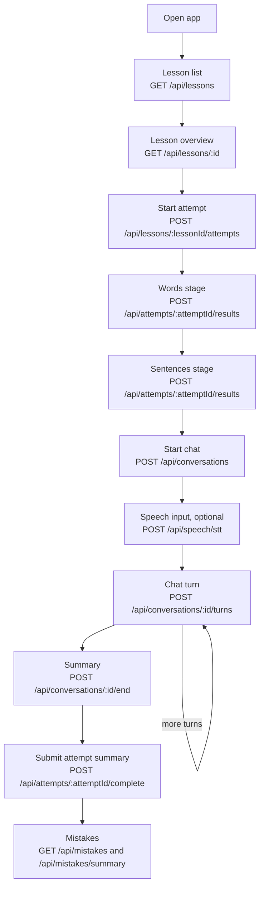

# System overview

## 1. What this is

Zubaan is a backend for guided English-learning lessons with scripted speaking practice.
It is a TypeScript Express API using MongoDB through Mongoose.
The local development command is `npm run dev`; the production commands are `npm run build` and `npm start`.
The repository does not define a deployment target or Render configuration; deployment behavior is therefore **Not implemented** here.
Lesson authoring files are seeded into MongoDB, and the HTTP API serves lesson data and records learner activity.

| Area               | Location                                          | Responsibility                                                    |
| ------------------ | ------------------------------------------------- | ----------------------------------------------------------------- |
| HTTP composition   | `src/app.ts`, `src/server.ts`                     | Express middleware, routes, startup                               |
| Routes/controllers | `src/routes/`, `src/controllers/`                 | Request validation and HTTP responses                             |
| Services           | `src/services/`                                   | Lesson, attempt, conversation, speech, mistake, and home behavior |
| Persistence        | `src/models/`                                     | Mongoose collections and indexes                                  |
| Lesson authoring   | `src/seed/lessons/`                               | Typed lesson content and validation                               |
| Providers          | `src/providers/`                                  | Sarvam LLM/STT/TTS and Kokoro TTS adapters                        |
| Configuration      | `src/config/env.ts`, `.env.example`               | Environment validation and defaults                               |
| Reference docs     | `docs/API_REFERENCE.md`, `docs/LESSON_CONTENT.md` | Endpoint and authoring references                                 |

## 2. Learner journey supported today



`GET /api/home` can provide one recommended lesson before the list. All lesson, attempt,
conversation, speech, and mistake routes require `x-user-id`; onboarding creates the user
with `POST /api/onboarding`. The exact response contracts are in
[API_REFERENCE.md](./API_REFERENCE.md).

## 3. LESSON ANATOMY

### `LessonContent`

`src/seed/lessons/types.ts` defines the authoring shape. The complete shape is:

| Field              | Meaning                                                                 |
| ------------------ | ----------------------------------------------------------------------- |
| `slug`             | Stable authoring identifier                                             |
| `title`            | Lesson title                                                            |
| `category`         | One of `daily`, `work`, `career`, `travel` from `src/types/content.ts`  |
| `level`            | One of `beginner`, `elementary`, `intermediate`, `advanced`             |
| `objective`        | Stated learning objective                                               |
| `estimatedMinutes` | Author-provided estimate                                                |
| `sentences`        | Canonical sentences used by exercises, speaking checks, and chat        |
| `stages`           | Data-defined stage objects with `id`, `title`, `intro`, and `exercises` |
| `chat`             | Roleplay metadata, ordered turns, and closing line                      |

Each sentence has `id`, English `text`, Hindi `hi`, pronunciation/grammar `tip`, and
`chunks`. `validateLesson` requires `chunks.join(' ') === text`.

The real `neighbour` lesson in `src/seed/lessons/neighbour.ts` has slug
`introduce-yourself-to-a-new-neighbour`, category `daily`, level `beginner`, and six
sentences. For example:

```ts
{
  id: 's1',
  text: 'Hi, I am your new neighbour.',
  hi: 'नमस्ते, मैं आपका नया पड़ोसी हूँ।',
  tip: 'Say "neighbour" as NAY-bur. The "gh" is silent.',
  chunks: ['Hi,', 'I am', 'your new', 'neighbour.']
}
```

The same lesson's `say-s1` exercise has `type: 'speak'` and `sentenceId: 's1'`.
Its first chat turn also has `sentenceId: 's1'`; the turn's `alternatives` contains
`Hello, I am your new neighbour.`. Thus `sentences` is the canonical source, while
exercise and chat references use IDs. `validateLesson` checks that every sentence has a
`speak` exercise and is asked by at least one chat turn. It checks references and duplicate
IDs, but does not enforce that there are exactly two stages or that their order is
`words` then `sentences`.

### Exercise types

The union is defined in `src/seed/lessons/types.ts`. The client renders the type-specific
fields and submits a result; `src/services/attemptService.ts` validates the result enum and
answer shape, but does not recompute most answers from the submitted answer.

| Type          | Purpose and fields                                                                    | Client/server answer behavior                                                                                                                         | Attempt and mistake bank                                                                                             |
| ------------- | ------------------------------------------------------------------------------------- | ----------------------------------------------------------------------------------------------------------------------------------------------------- | -------------------------------------------------------------------------------------------------------------------- |
| `mcq`         | Multiple choice: `prompt`, optional `promptHi`, `options`, `correct`, `explanation`   | Client selects an option and submits `correct` or `wrong`; server checks the result is allowed and the answer is a string                             | Result is stored. If wrong and `mistakeType` is set, the chosen option and `correct` become a mistake                |
| `gap`         | Fill `___`: `sentence`, `hi`, `options`, `correct`, `explanation`                     | Client selects a string and submits `correct` or `wrong`; server validates string length and builds the completed sentence for mistake text           | Result is stored. A typed `mistakeType` feeds the mistake bank                                                       |
| `listen_pick` | Listen to `text` and choose: `prompt`, `text`, `options`, `correct`, `explanation`    | TTS supplies `text`; client submits `correct` or `wrong`; validator requires `text === correct` in authoring                                          | Result is stored, but `mistakeType` is forbidden, so it does not feed the mistake bank                               |
| `match_pairs` | Match translations: `prompt` and 3–6 `{ en, hi }` pairs                               | Client submits `correct` or `wrong`; server does not validate pair selections                                                                         | Result is stored; `mistakeType` is forbidden, so no exercise mistake is created                                      |
| `order_words` | Build an English sentence: `promptHi`, `answer`, optional `extraWords`, `explanation` | Client submits a string array; server limits it to 30 words, 40 characters per word, and 500 joined characters, but does not compare it with `answer` | Result is stored. When wrong and `mistakeType` is set, the joined submitted words and `answer` feed the mistake bank |
| `speak`       | Say a referenced sentence: `sentenceId`                                               | Client submits `said`, `close`, `missed`, or `skipped`; server accepts the status and does not run STT or grade it here                               | Result is stored; `mistakeType` is forbidden, so no exercise mistake is created                                      |

For `mcq`, `gap`, and `order_words`, `mistakeType` may be `grammar`, `tense`,
`preposition`, or `word_choice`. The attempt keeps one first result per exercise;
duplicate submissions are ignored. A retry can set `retryResult` to `correct` or `wrong`
only after an existing first result.

### Stages and fixed rules

The TypeScript and Mongoose unions permit only stage IDs `words` and `sentences`.
The current lesson files put those stages in that order, but stage count and ordering are
data rather than an explicit runtime assertion. The scripted conversation has a fixed
three-attempt limit per chat turn (`MAX_ATTEMPTS = 3` in
`src/utils/scripted-lesson.ts`). There are no score weights or server-side score
calculation. `bestStreak` is supplied by the client when completing an attempt and is
bounded to 0–200.

### From authoring to client

1. A `LessonContent` value is exported from a file in `src/seed/lessons/`.
2. `assertLessonsValid()` calls `validateLesson` for all exports in
   `src/seed/lessons/index.ts`.
3. `npm run seed` calls `Lesson.replaceOne({ slug }, lesson, { upsert: true })` and
   deletes MongoDB lessons whose slugs are no longer in the exported list.
4. `src/models/Lesson.ts` stores the document and creates a unique indexed `slug` plus
   a `{ category, level }` index.
5. `GET /api/lessons` uses `toLessonListItem` and exposes only metadata, sentence count,
   and exercise count.
6. `GET /api/lessons/:id` exposes metadata, full sentences, stages, and chat metadata.
   The serializer exposes each chat turn's `ai`, `sentenceId`, and `hint`, but omits
   `alternatives`, `repeat`, and `knownMistakes`. It exposes `closingLine`.

Changing content requires editing and deploying the backend, then running the seed
against the deployment's MongoDB. There is no authoring or admin API.

### Adding a lesson

1. Add a typed `LessonContent` file under `src/seed/lessons/`.
2. Define unique sentence and exercise IDs; make each sentence's chunks join exactly.
3. Add `words` and `sentences` data using the existing exercise union.
4. Add one `speak` exercise and one chat turn for every sentence.
5. Add at least five chat turns and ensure all references are valid.
6. Export the lesson from `src/seed/lessons/index.ts`.
7. Run `npm run seed`; it stops before writes if validation fails.
8. Deploy the changed backend and verify the list/detail and learner flow.

The code does not measure authoring time. For an existing pattern, the mechanical work is
one content file plus one export and a seed/deploy; the actual duration is **Not
implemented** as a project metric and depends on writing and checking the content.

## 4. Scripted conversation engine

The scripted path is used whenever a lesson has chat turns. It does not call the LLM to
choose the reply. `Conversation.script` stores `turnIndex` and `attempts`, and each
conversation message stores `turnIndex`, outcome, optional correction, and audio URL.

`stepScript` in `src/utils/scripted-lesson.ts` normalizes the current answer and compares
it with the current sentence and its alternatives using token alignment. The decision
table is:

| Check        | Condition                                                                          | Result                                                      |
| ------------ | ---------------------------------------------------------------------------------- | ----------------------------------------------------------- |
| Exact        | All target words match after normalization, or only extra words were supplied      | `exact`; advance to the next turn                           |
| Close        | At least 50% of target words match but there are missing, replaced, or extra words | `close`; advance and return a correction                    |
| Off          | Empty input or less than 50% target-word match                                     | `off`; repeat while attempts remain                         |
| Out-of-order | Current answer matches another turn at least 80% but not the current turn          | Treated as `off`; repeat current turn, not the matched turn |
| Moved on     | `off` after the third attempt                                                      | `moved_on`; advance without a correction                    |

The first unrelated answer receives the turn's `repeat` line. The second also sets
`revealHint`; the client can reveal the hint already included in lesson data. The third
unrelated answer advances to the next turn. An exact or close answer resets attempts for
the next turn. The final successful or moved-on step returns `closingLine` and completes
the conversation.

Normalization lowercases text, converts curly apostrophes, removes non-alphanumeric
punctuation, expands the listed contractions (`I'm`, `I've`, `I'll`, `you're`, `we're`,
`they're`, `it's`, `there's`, `don't`, `doesn't`, `couldn't`), and maps the spelling
aliases `neighbor/neighbors` to `neighbour/neighbours` and `color/colors` to
`colour/colours`. It does not provide general synonym or semantic matching.

For close answers, automatic alignment describes up to two operations such as adding a
preposition, removing a word, correcting a preposition, recognizing a tense pair, or
fixing a close spelling/stem. A turn's `knownMistakes` override those automatic
explanations when their normalized wrong phrase occurs as a whole-word phrase; up to two
known explanations are used. The correction and explanation are stored on the user
message and inserted into the user's deduplicated mistake bank.

The scripted checker cannot judge meaning, broad paraphrases, or arbitrary word-order
tolerance. For example, `Could you tell me where the nearest shop is?` is compared as
an ordered token sequence; the code does not know that a semantically equivalent long
answer is acceptable. It also cannot grade pronunciation or audio quality in a
`speak` exercise. Non-scripted conversations use the configured LLM and have a separate
latest-message correction guard in `conversationLlmService.ts`.

## 5. Data model

| Collection/model | Fields                                                                                                                                                                                     | Relations and indexes                                                                                                        |
| ---------------- | ------------------------------------------------------------------------------------------------------------------------------------------------------------------------------------------ | ---------------------------------------------------------------------------------------------------------------------------- |
| `User`           | `name`, `nativeLanguage`, `level`, `goal`, `dailyGoalMinutes`, `placement.selfReported`, optional `placement.measured`, timestamps                                                         | `nativeLanguage`, level, goal use enums; no explicit indexes                                                                 |
| `Lesson`         | `slug`, `title`, `category`, `level`, `objective`, `estimatedMinutes`, `sentences`, `stages`, `chat`, timestamps                                                                           | `slug` is unique and indexed; compound `{ category, level }`; embedded sentence/stage/chat documents                         |
| `LessonAttempt`  | `lessonId`, `userId`, `startedAt`, optional `completedAt`, `bestStreak`, `results[]`                                                                                                       | References `Lesson` and `User`; indexes on `lessonId`, `userId`, and `{ userId, createdAt: -1 }`                             |
| `Conversation`   | `userId`, `lessonId`, optional `attemptId`, `status`, `messages[]`, `script.turnIndex`, `script.attempts`, `startedAt`, optional `endedAt`, `durationSec`, timestamps                      | References `User`, `Lesson`, and optionally `LessonAttempt`; indexes on `userId` and `{ userId, createdAt: -1 }`             |
| `Mistake`        | `userId`, optional `conversationId`/`attemptId`, `lessonId`, `original`, `corrected`, `explanation`, `type`, `source`, creation timestamp                                                  | References user/lesson/activity; indexes for user recency, user/type recency, and unique user/lesson/original/corrected/type |
| `SpeechLog`      | `kind`, `provider`, optional `voice`, `pace`, `mode`, `language`, optional `chars`, `audioSeconds`, `mimeType`, `audioBytes`, `durationMs`, `totalMs`, `ok`, optional `error`, `createdAt` | Index on `{ provider, createdAt: -1 }`; no user relation                                                                     |

The embedded `LessonAttempt.results` fields are `exerciseId`, `stageId`, `type`,
`result`, optional `retryResult`, `original`, `corrected`, `explanation`, and
`mistakeType`. Conversation messages have `role`, `text`, optional `audioUrl`,
correction, `turnIndex`, optional `revealHint`, optional outcome, and `createdAt`.

## 6. Scoring and progress

An attempt is created with `POST /api/lessons/:lessonId/attempts`. The client posts one
result per exercise and then posts `bestStreak` to
`POST /api/attempts/:attemptId/complete`. The server stores result status and selected
mistake text, but does not calculate a numeric score or weights.

Conversation completion stores all messages, status, timestamps, duration, and optional
attempt relation. Its summary is calculated from stored messages plus the lesson
sentences: user turn count, duration, correction count, corrections, and target phrases
used or missed. It is not stored as a separate summary collection.

Per-user data is available through owned attempts, conversations, and the mistake bank.
Mistakes are deduplicated by user, lesson, original, corrected, and type, and can be
listed with a type filter and cursor or counted by type.

The backend does not track resume state, streak history, lesson completion history,
lesson ordering, lesson unlocking, or a progress aggregate. A conversation can be
completed, but there is no route that marks a lesson as completed.

## 7. Speech

| Function           | Providers and behavior                                                                                                              |
| ------------------ | ----------------------------------------------------------------------------------------------------------------------------------- |
| TTS                | `kokoro` and `sarvam`; selected by `TTS_PROVIDER` or request `provider`                                                             |
| STT                | `sarvam` only; selected by `STT_PROVIDER` or request `provider`                                                                     |
| Modes              | Sarvam STT accepts `transcribe`, `verbatim`, `codemix`, and `translit`; default is `codemix`                                        |
| Silent-audio guard | Before STT, WAV measurement rejects peak below `0.03` or duration below `0.3` seconds with `AUDIO_TOO_QUIET`                        |
| Limits             | Upload size defaults to 10 MiB and duration defaults to 30 seconds; supported MIME types are listed in `src/providers/stt/index.ts` |

TTS currently accepts `en-IN`, `hi-IN`, `ta-IN`, and `te-IN`. Kokoro rejects every
language except `en-IN`; Sarvam maps those four codes to its API. STT exposes a wider
Indian-language code list, including Hindi and English, but only the Sarvam provider is
implemented. Scripted conversation audio is hard-coded to `en-IN` in
`synthesizeConversationAudio`. Lesson authoring requires a Hindi `Sentence.hi`, Hindi
gap/prompt fields, and Hindi chat hints. The conversation prompt says to lead an
English roleplay. These are the current language constraints.

## 8. Identity and security

Protected routes use `attachUser`: the caller supplies `x-user-id`, which must be a valid
MongoDB ObjectId for an existing `User`. Ownership queries include that user ID for
attempts, conversations, and mistakes. Onboarding and health are unprotected; generated
`/audio/*` files are static and unprotected. There is no JWT/session verification even
though `JWT_SECRET` is required by environment validation.

`helmet` and CORS are enabled. CORS allows the two localhost origins and
`https://zubaan-web.vercel.app`. There is no rate-limiting middleware. JSON and URL-encoded
bodies are limited to 1 MiB; conversation text is 500 characters; LLM replies are 600
characters; TTS text is 2,500 characters; STT uploads are limited by
`STT_MAX_FILE_SIZE_BYTES` and duration by `STT_MAX_DURATION_SECONDS`.

## 9. Cost and performance

| Potentially billable call | When it occurs                                                                                                                 | Cache/mock behavior                                                                                     |
| ------------------------- | ------------------------------------------------------------------------------------------------------------------------------ | ------------------------------------------------------------------------------------------------------- |
| Sarvam LLM                | Only the non-scripted conversation branch, once per user turn, with up to the last 10 messages; invalid output is retried once | `LLM_PROVIDER=mock` uses deterministic local rules and replies; scripted lesson turns do not use an LLM |
| TTS                       | Conversation opening and every reply; direct `/api/speech/tts` requests                                                        | Audio is cached on disk by provider/model/language/voice/pace/text; cache hits do not call the provider |
| Sarvam STT                | Each `/api/speech/stt` request after validation and silence/duration checks                                                    | No STT cache; an English non-Latin result can trigger a second `translit` provider call                 |

Speech calls write `SpeechLog` records for success and failure. The default TTS provider is
Kokoro, but Kokoro still calls the configured `KOKORO_TTS_URL`; it is not an in-process
free mock. The mock setting applies only to LLM. STT has no mock/free provider.

## 10. Configuration

The `.env.example` values are examples. Runtime defaults and requiredness come from
`src/config/env.ts`; `MONGODB_URI`, `JWT_SECRET`, `NODE_ENV`, `PORT`, and `LLM_PROVIDER`
are required at runtime.

| Variable                   | Runtime default / requirement                             | Purpose                                                    |
| -------------------------- | --------------------------------------------------------- | ---------------------------------------------------------- |
| `NODE_ENV`                 | Required: `development`, `test`, or `production`          | Runtime environment                                        |
| `PORT`                     | Required; `.env.example`: `5000`                          | HTTP port                                                  |
| `MONGODB_URI`              | Required; example empty                                   | MongoDB connection                                         |
| `JWT_SECRET`               | Required; example empty                                   | Validated secret; request auth does not use JWT            |
| `LLM_PROVIDER`             | Required; example `mock`                                  | `mock` or `sarvam` conversation provider                   |
| `TTS_PROVIDER`             | `kokoro`; example `kokoro`                                | `kokoro` or `sarvam`                                       |
| `STT_PROVIDER`             | `sarvam`; example `sarvam`                                | STT provider; only Sarvam is implemented                   |
| `SARVAM_STT_MODE`          | `codemix`; example `codemix`                              | Default Sarvam STT mode                                    |
| `SARVAM_API_KEY`           | Optional unless Sarvam LLM/TTS/STT is selected            | Sarvam authentication                                      |
| `SARVAM_LLM_MODEL`         | Optional unless Sarvam LLM is selected                    | Sarvam model: `sarvam-105b` or `sarvam-105b-conversations` |
| `SARVAM_TTS_VOICE`         | Optional; provider fallback is `shubh`                    | Sarvam voice                                               |
| `SARVAM_TTS_PACE`          | Optional; provider fallback is `1`                        | Sarvam pace, 0.5–2                                         |
| `SARVAM_TTS_TIMEOUT_MS`    | `30000` in runtime schema; example `15000`                | Sarvam TTS timeout                                         |
| `SARVAM_STT_TIMEOUT_MS`    | `15000`                                                   | Sarvam STT timeout                                         |
| `STT_MAX_FILE_SIZE_BYTES`  | `10485760`                                                | Maximum in-memory STT upload size                          |
| `STT_MAX_DURATION_SECONDS` | `30`                                                      | Maximum STT duration                                       |
| `KOKORO_TTS_URL`           | `https://tts-system.vercel.app/api/tts` in runtime schema | Kokoro-compatible TTS endpoint                             |
| `KOKORO_TIMEOUT_MS`        | `90000`                                                   | Kokoro timeout                                             |

## 11. SUSPECTED HOLES

1. **Hindi is embedded in the lesson contract** — `src/seed/lessons/types.ts` requires
   `Sentence.hi`, and lesson prompts/hints in `neighbour.ts` are Hindi. This makes a
   non-Hindi learner or translated lesson require schema/content changes. **Size: large.**
2. **TTS language support is narrower than user languages** — `src/types/content.ts`
   accepts ten native-language codes, while `src/providers/tts/index.ts` supports four
   output codes and Kokoro supports only English. **Size: medium.**
3. **No lesson-level progression rules** — levels exist as enums and recommendation
   chooses a nearest lesson, but there is no ordering, unlocking, or completion gate.
   **Size: medium.**
4. **Stage shape is under-validated** — `validateLesson` checks exercise IDs and
   references but not exactly two stages or the required order, so a malformed order can
   reach the client. **Size: small.**
5. **Client-provided grading and streak** — attempt results and `bestStreak` are accepted
   from the client within limited enums/ranges; most exercise answers are not compared to
   their canonical answer on the server. **Size: medium.**
6. **Speech exercises are not server-verified** — `speak` accepts `said`, `close`,
   `missed`, or `skipped` without linking the result to STT or pronunciation analysis.
   **Size: medium.**
7. **No rate limiting** — `src/app.ts` has no rate-limit middleware although LLM, TTS,
   and STT routes can create provider cost. **Size: medium.**
8. **Potential unbounded lesson listing/detail payloads** —
   `lessonService.ts` returns all matching lessons and their counts, while detail returns
   full stages and chat. There is no pagination or lesson payload cap. **Size: medium.**
9. **Some query indexes are absent** — `Mistake` has no standalone lesson index and
   `SpeechLog` has no time-only index; user-level queries are indexed, but operational
   retention/reporting queries could degrade with growth. **Size: medium.**
10. **Content changes require deployment and seeding** — the only content path is the
    compiled authoring list plus `npm run seed`; there is no admin/editor endpoint.
    **Size: medium.**
11. **Conversation turns can be consumed without success** — the three-attempt rule moves
    on after unrelated answers, so a learner can finish while missing every target phrase.
    **Size: small.**
12. **No authenticated identity boundary** — possession of another user's ObjectId is
    sufficient to act as that user; `JWT_SECRET` does not change this. **Size: large.**
13. **Speech log writes do not identify a user** — `SpeechLog` stores provider and request
    measurements but no user ID, so per-user cost attribution is unavailable. **Size: medium.**
14. **Concurrency is only partially addressed** — conversation user-message append has an
    atomic active/turn-count condition, but there is no explicit uniqueness or lifecycle
    policy preventing multiple active attempts or conversations for the same lesson.
    **Size: medium.**

## 12. NOT IMPLEMENTED

- Login, sessions, JWT authentication, password/account recovery, and user profile routes.
- Lesson ordering, unlocking, prerequisites, completion history, and progress aggregation.
- Resume/reopen of an in-progress lesson or conversation.
- Reminders, streak history, and scheduled notifications.
- Spaced review or due scheduling for the mistake bank.
- Analytics dashboards, event analytics, and per-user speech cost attribution.
- Admin tools, lesson editing, content publishing, and runtime lesson import.
- Server-side pronunciation scoring for `speak` exercises.
- Numeric score calculation and score weights.
- Vocabulary tracking and placement voice assessment.
- A deployed service definition or Render configuration in this repository.
